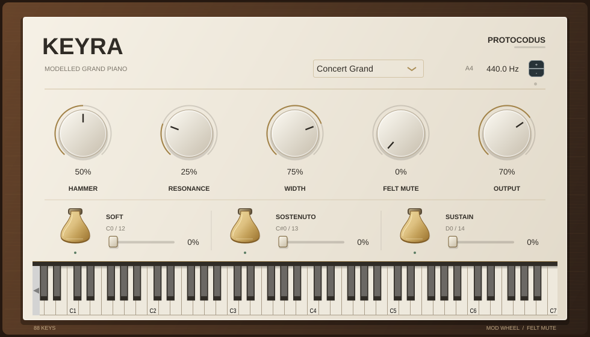
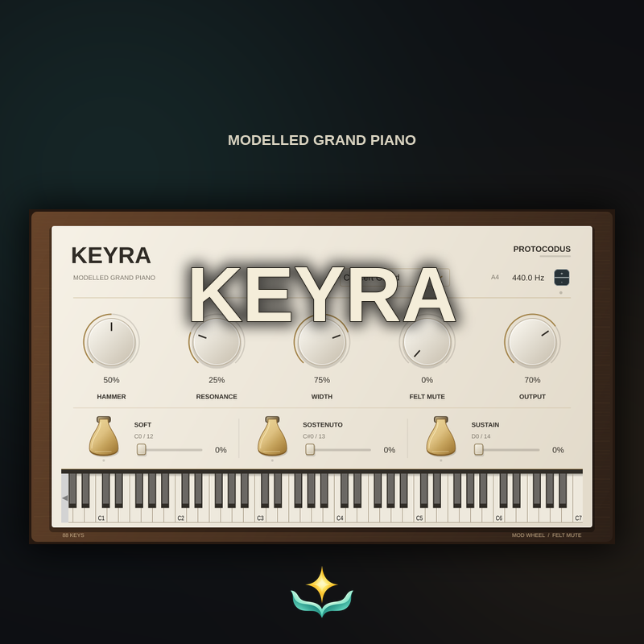

# Tagline

Keyra Modelled Grand Piano.

# Top features

* Sample-free, continuously voiced piano
* Three pedals with dedicated keyswitches
* Felt muting from the modulation wheel

# Intro

Keyra brings a continuously voiced, sample-free grand piano into a walnut-and-ivory instrument interface, with three visible brass pedals and direct control over the touch, resonance and stereo image.

# Product desc

Keyra generates its tone from tuned, dispersive string modes, each with the beating and stereo spread of its unison strings, over a measured soundboard ring and the noise of the board under every strike. Numerical voicing comes from 264 recordings of a grand piano; the sound engine does not play back recorded notes or impulse responses.

The soft, sostenuto and sustain pedals can be held on screen or played from MIDI. Dedicated momentary keyswitches sit below the piano range: C0 / MIDI 12 for soft, C#0 / MIDI 13 for sostenuto and D0 / MIDI 14 for sustain, using C4 = MIDI 60. Continuous sliders and standard CC67, CC66 and CC64 messages provide pedal depth, with visible pedal travel following the effective performance state.

The felt mute adds smooth damping even while keys remain held. Move the modulation wheel to bring it in during a phrase, or set its depth directly. Hammer brightness, sympathetic resonance, stereo width, concert tuning and output level shape the instrument around a performance.

Five authored presets offer concert, studio, warm, felt and open-string starting points. The DAW front end provides VST3 and CLAP plug-ins, an Audio Unit on macOS and a standalone instrument, sample-accurate MIDI scheduling, persistent panel parameters and a playable on-screen keyboard. Momentary pedal performances remain separate from the saved panel settings.

## Version history

### 0.4.0

Native instrument with a real-time modal core voiced from 264 recordings of a grand piano, with a measured soundboard ring and board noise, five presets, three visible pedals, momentary pedal keyswitches, continuous pedal depth and modulation-wheel felt muting, as VST3, CLAP, Audio Unit and standalone builds.

# Images

