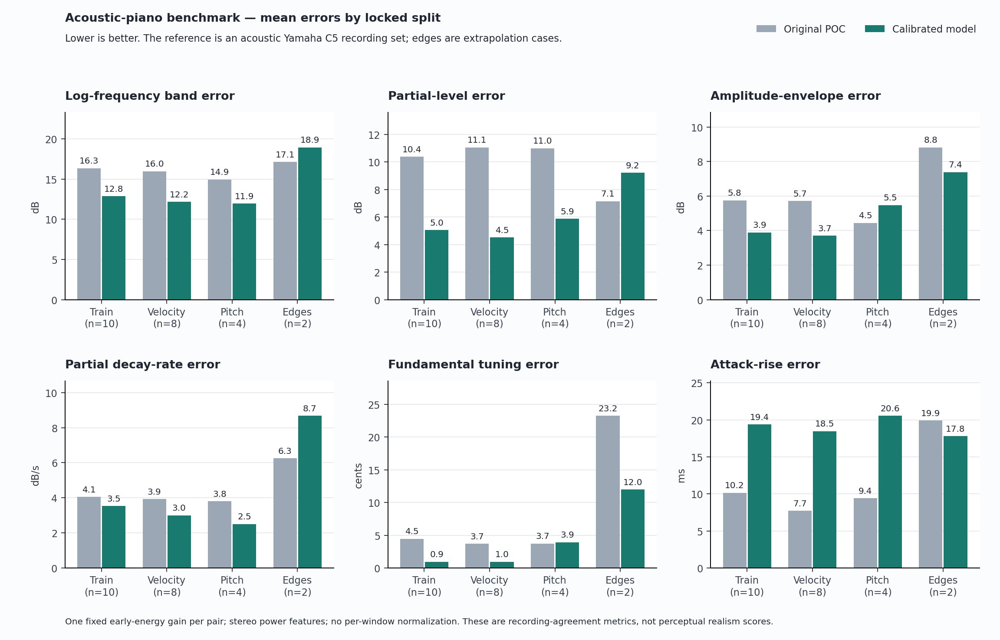
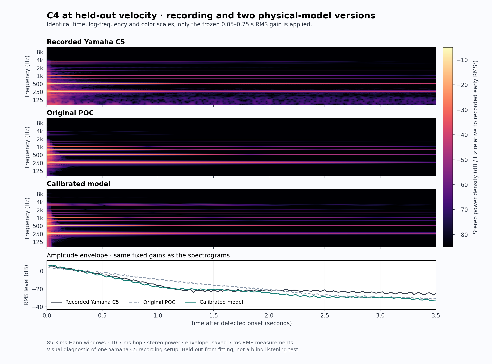

# Real-recording benchmark

This benchmark compares isolated notes from the physical model with **Salamander Grand Piano V3 by Alexander Holm**. It measures reproducible agreement in tuning, partial balance, decay and envelope. It is not a perceptual realism score, a blind listening test or a claim of equivalence to the acoustic instrument.

**Status:** all 24 frozen-candidate note renders and comparisons are complete. The final candidate was selected before held-out evaluation; no parameters were changed in response to those results. Six level-matched listening triplets and all five 192 kHz musical/diagnostic renders are complete.

## Recordings and provenance

The source is [sfzinstruments/SalamanderGrandPiano](https://github.com/sfzinstruments/SalamanderGrandPiano), pinned at commit `3382bf9496bba2486f5ab0de55a264d1dfc38404`. Alexander Holm's recordings are distributed under [Creative Commons Attribution 3.0 Unported](https://creativecommons.org/licenses/by/3.0/). See [local attribution](reference/ATTRIBUTION.md), the [upstream description](https://sfzinstruments.github.io/pianos/salamander/) and [original release](https://archive.org/details/SalamanderGrandPianoV3).

Upstream describes a Yamaha C5 acoustic grand captured at 48 kHz/24 bit using two AKG C414 microphones in AB configuration approximately 12 cm above the strings. The full set has 16 velocity layers and minor-third sampling. We selected 24 isolated sustain files. Original FLAC downloads are unchanged; WAV copies are lossless PCM24 decodes with no local trimming, normalization, EQ or retuning. The alternative retuned SFZ mapping is not applied. Separate hammer, string-resonance and pedal-release sample layers are not mixed into these notes.

[reference/manifest.json](reference/manifest.json) records file URLs, hashes, source commit, source SFZ ranges and decode provenance. The upstream license is preserved at [reference/upstream/LICENSE-CC-BY-3.0.txt](reference/upstream/LICENSE-CC-BY-3.0.txt).

Room details, acquisition pedal state, physical hammer speed, exact key release and earlier editing history are undocumented. The benchmark treats these as recording-domain uncertainties, not as measured synthesis parameters. In particular, it does not validate pedal or release realism.

## Locked split and input mapping

[benchmark/split.json](benchmark/split.json) is authoritative; the manifest's suggested split is advisory. The split was fixed before fitting:

| Split | Recordings | Count |
|---|---|---:|
| Training | C2, C3, C4, C5, C6 × layers 4 and 12 | 10 |
| Held-out velocity | C2–C6 at layer 8; C3–C5 at layer 6 | 8 |
| Held-out pitch | F♯2, F♯3, F♯4, F♯5 at layer 8 | 4 |
| Edge extrapolation | C1 and C7 at layer 8 | 2 |

The mechanical and radiation fitting stages read only the ten training cases. The held-out files supply evaluation measurements, not optimization targets. Baseline reference features were inspected before fitting, so this is not a blinded development study. The final candidate was frozen before its held-out evaluation. The two edge notes are reported separately because the fitted pitch anchors span C2–C6.

| Recording layer | SFZ velocity range | Model input |
|---|---:|---:|
| 4 | 37–43 | 40 |
| 6 | 47–50 | 49 |
| 8 | 57–64 | 61 |
| 12 | 89–96 | 93 |

These model inputs are rounded SFZ-bin midpoints. They do not establish the MIDI value or physical strike velocity used during recording. Cross-layer dynamic ratios are useful diagnostics but retain that uncertainty.

## Matched model renders

The bundled standalone [v1 source](benchmark/baseline_source/grand.cpp) is the baseline, with SHA-256 `0f45e67c7be38e81a0bab0525f125b5d776be748e1fdceae854f0a45d6f848f3`. V1 and v2 use identical benchmark events: note-on at 0.1 s, note-off at 4.15 s, duration 4.35 s, 96 kHz internal synthesis and model pedal set to zero. Model pedal zero is a declared test condition, not an inference about the recording pedal.

The benchmark uses the dry model signal, without presentation reverb. [tools/benchmark_render.py](tools/benchmark_render.py) records source, binary, calibration, score and output hashes where applicable. The complete v2 implementation includes both `src/grand.cpp` and its generated `src/calibration.h`; a source hash alone does not freeze the parameters. The `--uncalibrated` switch is a useful local ablation but does not replace the preserved v1 baseline.

The [rate-convergence check](validation/rate-convergence.json) confirms that the current binary reproduces the frozen 96 kHz C4 layer-12 render bit-for-bit. Comparing that one training note at 96 and 192 kHz gives log-band/partial-level differences of 0.0135/0.0191 dB and an envelope difference of 0.0031 dB, with no refitting. It supports the rate choice for this case, not a full-keyboard convergence claim.

## Measurement protocol

[tools/benchmark.py](tools/benchmark.py) detects onset with a noise-aware 1 ms RMS envelope, then analyzes four seconds of onset-aligned audio. The detector uses a threshold near −45 dB relative to the first-second peak, raised where necessary above the measured noise floor.

Stereo powers are averaged rather than summing channel waveforms. This prevents phase cancellation from making a stereo recording appear silent. For each recording/model pair, one scalar gain matches early RMS over 0.05–0.75 s:

```text
gain = reference_early_RMS / model_early_RMS
```

The same gain applies throughout the note. There is no independent normalization of each time window, harmonic or decay segment. Therefore level evolution remains visible, while absolute microphone gain is excluded. Because this matching removes between-note loudness differences, soft/hard ratios must also be checked separately.

The four spectral windows are 0.05–0.25, 0.25–0.75, 0.75–1.5 and 1.5–3.5 s after onset. Metrics are:

| Metric | Definition and interpretation |
|---|---|
| Log-band MAE, dB | Error of half-octave power bands from 31.25 Hz through the audible range. A −70 dB floor and reference-above-−50 dB mask reduce noise-floor domination. Broad-band spectrum includes nonharmonic energy. |
| Harmonic MAE, dB | Partial-band power error across the four windows, centered on each signal's own fitted partial frequencies. Reference partials weaker than about −50 dB relative to early power are excluded. This emphasizes balance and evolution rather than pitch misalignment. |
| Envelope MAE, dB | Error of short-window RMS evolution through 3.5 s, with the same early gain and a reference-above-−50 dB mask. |
| Decay MAE, dB/s | Difference between robust Theil–Sen partial-power decay slopes over 0.25–3.5 s. Reference fits require R² > 0.25 and adequate partial level. |
| Fundamental absolute error, cents | Absolute difference of fitted f₁. |
| Partial tuning MAE, cents | Mean absolute difference of measurable partial frequencies among the first ten partials after fitting the stiff-string series. |
| Attack error, ms | Difference of 10–90% rise times in the first 150 ms, measured with a 5 ms RMS envelope. This is an attack proxy, not a measurement of felt-contact duration. |

Fundamental and inharmonicity are fitted jointly. The feature files retain noise and tuning-confidence diagnostics. C7 does not supply enough reliable higher partials to identify B; its B is reported as unavailable and higher-partial interpretation is restricted. A finite error value is not proof that every physical parameter is identifiable.

The synthetic checks in [benchmark/measurement-validation.json](benchmark/measurement-validation.json) verify known pitch/inharmonicity/decay recovery, invariance to overall gain and resistance to opposite-polarity stereo cancellation. They validate the measurement implementation on controlled signals, not the realism of the synthesizer.

## Completed baseline results

The spectral and envelope errors are mean absolute errors (MAE), not root-mean-square errors. Values below are arithmetic means across cases in each split; lower is better. Different metrics describe different errors and are not combined into a single quality percentage.

| V1 set | Cases | Log-band dB | Harmonic dB | Envelope dB | Decay dB/s | Fundamental cents | Partial cents | Attack ms |
|---|---:|---:|---:|---:|---:|---:|---:|---:|
| Training | 10 | 16.34 | 10.38 | 5.76 | 4.05 | 4.46 | 5.28 | 10.15 |
| Held-out velocity | 8 | 15.96 | 11.05 | 5.72 | 3.92 | 3.68 | 5.26 | 7.72 |
| Held-out pitch | 4 | 14.93 | 10.99 | 4.45 | 3.81 | 3.73 | 5.01 | 9.42 |
| Edge extrapolation | 2 | 17.12 | 7.15 | 8.82 | 6.25 | 23.24 | 19.69 | 19.90 |

Complete case-level measurements: [benchmark/baseline_report.json](benchmark/baseline_report.json).

### Intermediate mechanical calibration — training only

This evaluation predates the final calibrated radiation observation. It is useful evidence about what the mechanical stage fixes and what it does not. It must not be read as held-out generalization or final v2 quality.

| Training mean | Frozen v1 | Mechanical stage |
|---|---:|---:|
| Log-band MAE, dB | 16.34 | 16.80 |
| Harmonic MAE, dB | 10.38 | 9.50 |
| Envelope MAE, dB | 5.76 | 5.24 |
| Decay MAE, dB/s | 4.05 | 3.67 |
| Fundamental absolute error, cents | 4.46 | 0.68 |
| Partial tuning MAE, cents | 5.28 | 0.68 |
| Attack error, ms | 10.15 | 10.54 |

The stage improves tuning, partial balance and mean decay/envelope agreement while worsening broad-band spectral and attack error. This motivates separate output-observation calibration; it does not establish a uniform improvement. Source: [benchmark/mechanics_report.json](benchmark/mechanics_report.json).

The training recordings also expose excessive v1 velocity contrast: hard/soft early-RMS ratios range from about 1.9–3.9 in the reference and 4.3–15.3 in v1 across C2–C6. V2 uses shallower register-dependent velocity curves. These ratios need their own evaluation because pairwise gain matching deliberately removes this difference.

### Final candidate

The final radiation-calibrated candidate uses source SHA-256 `732f2ef6054b6536197351cab928ecadbcdd05ef870f533db93ec04ff88e8889` and calibration-header SHA-256 `619d6bf4d3200a6b55007a1abcc0658e76a14124ce5f3abad9f5f4b94d8979f7`. [The render manifest](benchmark/candidate/render-manifest.json) binds these to the executable and all 24 outputs. [The complete report](benchmark/candidate_report.json) contains every case and metric.

| V2 set | Cases | Log-band dB | Harmonic dB | Envelope dB | Decay dB/s | Fundamental cents | Partial cents | Attack ms |
|---|---:|---:|---:|---:|---:|---:|---:|---:|
| Training | 10 | 12.85 | 5.04 | 3.89 | 3.53 | 0.93 | 0.78 | 19.39 |
| Held-out velocity | 8 | 12.16 | 4.51 | 3.71 | 2.99 | 0.95 | 0.80 | 18.48 |
| Held-out pitch | 4 | 11.95 | 5.87 | 5.48 | 2.50 | 3.92 | 2.75 | 20.55 |
| Edge extrapolation | 2 | 18.93 | 9.21 | 7.38 | 8.68 | 11.98 | 10.86 | 17.79 |

Across the 12 cases excluded from fitting within the anchor range, harmonic-level MAE falls from **11.03 to 4.96 dB**, log-band MAE from **15.62 to 12.09 dB**, and decay-slope MAE from **3.88 to 2.83 dB/s**. These correspond to 55%, 23% and 27% reductions in those errors, respectively. They are not percentages of perceptual realism.

The regressions are material:

- Mean attack-rise error across those 12 cases increases from **8.29 to 19.17 ms**. C2/C3 examples account for several of the largest increases. Better sustained spectra do not establish a better hammer attack.
- All four F♯ pitch-interpolation cases have worse envelope error: the split mean rises from **4.45 to 5.48 dB**. Fundamental error also rises slightly, **3.73 to 3.92 cents**, despite lower mean partial-tuning error.
- F♯5 worsens in both log-band (**13.90→15.64 dB**) and harmonic-level error (**3.69→6.31 dB**). Interpolated timbre is not uniformly improved.
- Upper-register decay remains problematic: C6 layer 12 worsens from **5.12 to 9.96 dB/s**, and C6 layer 8 from **3.96 to 6.34 dB/s**. A lower aggregate decay error must not be interpreted as uniformly improved aftersound.
- The C1/C7 edge mean worsens in log-band (**17.12→18.93 dB**), harmonic (**7.15→9.21 dB**) and decay error (**6.25→8.68 dB/s**). C1 envelope error also rises **3.78→6.54 dB**. C7 inharmonicity is not identifiable from this recording, so its high-frequency/tuning results have additional limitations.

Separate dynamics checks use early RMS before pairwise level matching:

| Training pitch | Reference hard/soft ratio | V1 | V2 |
|---|---:|---:|---:|
| C2 | 1.91 | 4.30 | 1.76 |
| C3 | 1.95 | 4.40 | 1.75 |
| C4 | 2.48 | 5.16 | 2.15 |
| C5 | 2.29 | 5.70 | 1.99 |
| C6 | 3.93 | 15.26 | 2.97 |

V2 reduces the excessive v1 contrast at every training anchor, but now undershoots each recorded ratio. These are training diagnostics, and the SFZ-to-strike mapping remains uncertain. The frozen candidate is retained with these limitations; the held-out results were not fed back into fitting.

## Plots and listening comparisons

The [generated report](benchmark/report/report.md) includes every case and every metric regression, with [machine-readable case data](benchmark/report/all_case_metrics.csv) and a [regression table](benchmark/report/regressions.csv).



The C4 layer-8 diagnostic uses the saved early-RMS model gains and a shared 80–12,000 Hz frequency axis, 0–3.5 s time axis and −85 to −5 dB/Hz color scale. Its envelope overlay exposes improved early-decay agreement and remaining late-tail mismatch. This is a visual diagnostic, not another quality score. [Plot parameters and input hashes](benchmark/report/C4v8-spectrogram.json) preserve the exact inputs.



The [six listening triplets](README.md#listen) play real → v1 → v2 at segment starts 0.00, 4.60 and 9.20 s. Each excerpt retains 50 ms before detected onset, four seconds of attack/decay and a 15 ms end fade. A 0.55 s gap separates excerpts. The same early-RMS model matching used by the benchmark remains fixed throughout each note. One final gain applies to the entire triplet set; the maximum estimated true peak is −2 dBTP. There is no room effect, compression or limiting.

The [listening manifest](listening/manifest.json) preserves source hashes, model gains, output hashes and Alexander Holm's recording attribution. Reference excerpts are modified only for alignment, excerpt length, end fade, common presentation gain and concatenation. This is a labeled listening comparison, not a blind experiment.

## Reproduce the evidence

From this directory:

```sh
python3 reference/fetch_reference.py
python3 reference/fetch_reference.py --verify-only
python3 tools/benchmark.py self-test
python3 tools/benchmark.py extract --input-dir reference/wav --output benchmark/reference_features.json
```

The first command downloads the original licensed FLACs from pinned URLs and recreates decoded WAV references. Audio originals and native render WAVs are not tracked in this source checkout. The second verifies the pinned local references. In the full local working folder, decoded WAVs already exist and verification alone suffices. WAV container hashes can depend on the decoder version. The verifier therefore checks the pinned decoded PCM24 sample hash together with sample rate, channels, frame count and bit depth; a header-only difference is accepted only when this complete audio identity matches. Original FLAC hashes must still match exactly. [Restore validation](validation/reference_restore.json) checks all 24 originals, accepts an alternate WAV container with identical audio and rejects changed samples, rate/channels and corrupted FLAC.

To compare an existing complete render directory:

```sh
python3 tools/benchmark.py compare \
  --reference benchmark/reference_features.json \
  --model-dir benchmark/baseline \
  --output benchmark/baseline_report.json
```

To render a fresh complete candidate set after building `build/grand` with the normal renderer:

```sh
python3 tools/benchmark_render.py \
  --engine build/grand --source src/grand.cpp \
  --label reproduce --rate 96000 --jobs 4
python3 tools/benchmark.py compare \
  --reference benchmark/reference_features.json \
  --model-dir benchmark/reproduce \
  --output benchmark/reproduce_report.json
```

The included baseline can also be rebuilt without the sibling v1 folder:

```sh
mkdir -p build
c++ -std=c++17 -O3 benchmark/baseline_source/grand.cpp -o build/grand-v1
python3 tools/benchmark_render.py \
  --engine build/grand-v1 --source benchmark/baseline_source/grand.cpp \
  --label baseline_reproduce --rate 96000 --jobs 4
```

`--allow-missing` is reserved for explicitly partial intermediate evaluations such as the ten training-only mechanical renders. A final aggregate requires all expected cases. [tools/benchmark_render.py](tools/benchmark_render.py) supplies matched events and manifests; pass the intended executable, corresponding source and a distinct label. Preserve the frozen baseline rather than overwriting it during experiments.

The calibration header is generated from [benchmark/calibration.json](benchmark/calibration.json). Re-running mechanical estimation resets the radiation calibration. [The reproduction check](validation/calibration-reproduction.json) regenerated both the profile and header byte-for-byte from the mechanical stage plus saved radiation proposal. The `header` stage regenerates the current checked-in profile without refitting; the `radiation` stage applies the saved radiation proposal after checking its training IDs and finite values. Keep both stages, training IDs, fit reports and exact source/header hashes when reproducing a finished profile.

## Scope of the conclusion

These recordings can show whether tuning, timbre and decay are closer to one captured grand in controlled isolated-note comparisons. They cannot prove broader acoustic realism, commercial-instrument parity, accurate pedal behavior or reproduction of an unobserved microphone position. Unknown acquisition choices, noise, spectral leakage and the single-instrument sample size limit interpretation. Dry musical listening, separate dynamics checks and held-out cases complement the metrics; a controlled blind listening study remains outstanding.
