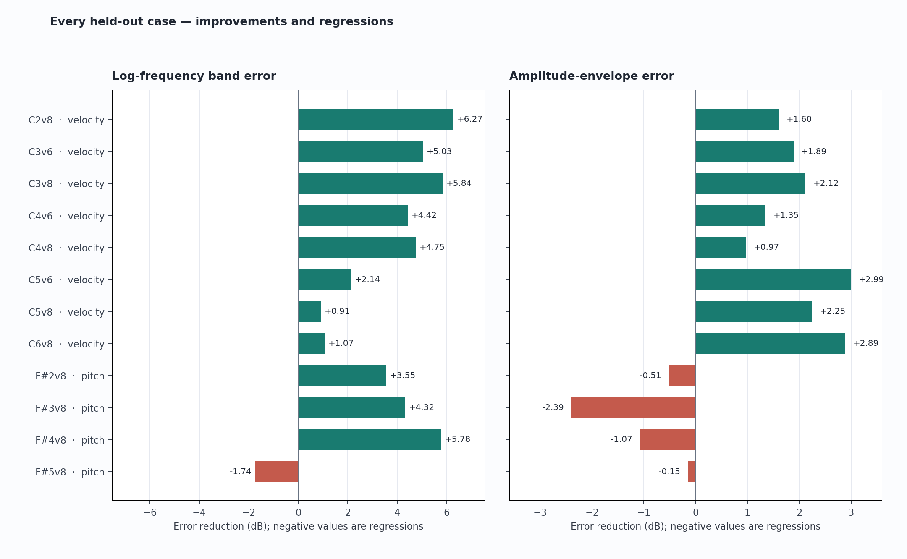

# Acoustic-piano benchmark: original and calibrated models

The comparison uses 24 acoustic Yamaha C5 sample recordings and the same frozen analysis for both model versions. Ten recordings supplied parameter fitting; fourteen did not. These measurements quantify agreement with this recording setup. They do not establish acoustic indistinguishability or a percentage of realism.

## Mean errors by split

| Split | Cases | Band error (dB) | Partial levels (dB) | Envelope (dB) | Decay rate (dB/s) | Fundamental (cents) | Attack (ms) |
|---|---:|---:|---:|---:|---:|---:|---:|
| Training | 10 | 16.34 → 12.85 | 10.38 → 5.04 | 5.76 → 3.89 | 4.05 → 3.53 | 4.46 → 0.93 | 10.15 → 19.39 |
| Held-out velocity | 8 | 15.96 → 12.16 | 11.05 → 4.51 | 5.72 → 3.71 | 3.92 → 2.99 | 3.68 → 0.95 | 7.72 → 18.48 |
| Held-out pitch | 4 | 14.93 → 11.95 | 10.99 → 5.87 | 4.45 → 5.48 | 3.81 → 2.50 | 3.73 → 3.92 | 9.42 → 20.55 |
| Keyboard edges | 2 | 17.12 → 18.93 | 7.15 → 9.21 | 8.82 → 7.38 | 6.25 → 8.68 | 23.24 → 11.98 | 19.90 → 17.79 |

Each cell shows original → calibrated. Lower is better. Means use only comparable case pairs; metric-specific counts are preserved in comparison.json.

## Held-out cases

## All regressions

Every case/metric increase above numerical tolerance is listed below, including training and edge cases. No regressing case was omitted from the aggregate.

| Case | Split | Metric | Original | Calibrated | Increase |
|---|---|---|---:|---:|---:|
| C2v4 | Training | Attack-rise error (ms) | 16.823 | 44.729 | +27.906 |
| C2v12 | Training | Attack-rise error (ms) | 33.656 | 45.635 | +11.979 |
| C3v4 | Training | Attack-rise error (ms) | 5.500 | 31.771 | +26.271 |
| C3v12 | Training | Attack-rise error (ms) | 1.979 | 25.156 | +23.177 |
| C4v4 | Training | Fundamental tuning error (cents) | 0.348 | 1.043 | +0.694 |
| C4v12 | Training | Fundamental tuning error (cents) | 0.527 | 1.011 | +0.483 |
| C5v4 | Training | Attack-rise error (ms) | 12.750 | 17.375 | +4.625 |
| C5v12 | Training | Partial decay-rate error (dB/s) | 2.412 | 3.453 | +1.041 |
| C6v12 | Training | Partial decay-rate error (dB/s) | 5.116 | 9.957 | +4.841 |
| C6v12 | Training | Attack-rise error (ms) | 5.917 | 7.385 | +1.469 |
| C2v8 | Held-out velocity | Attack-rise error (ms) | 17.375 | 45.385 | +28.010 |
| C3v6 | Held-out velocity | Attack-rise error (ms) | 5.438 | 32.125 | +26.688 |
| C3v8 | Held-out velocity | Attack-rise error (ms) | 4.958 | 32.000 | +27.042 |
| C4v6 | Held-out velocity | Fundamental tuning error (cents) | 0.415 | 1.058 | +0.643 |
| C4v8 | Held-out velocity | Fundamental tuning error (cents) | 0.525 | 1.045 | +0.520 |
| C5v6 | Held-out velocity | Attack-rise error (ms) | 13.927 | 17.542 | +3.615 |
| C5v8 | Held-out velocity | Attack-rise error (ms) | 13.740 | 17.104 | +3.365 |
| C6v8 | Held-out velocity | Partial decay-rate error (dB/s) | 3.959 | 6.339 | +2.380 |
| F#2v8 | Held-out pitch | Amplitude-envelope error (dB) | 3.466 | 3.979 | +0.513 |
| F#2v8 | Held-out pitch | Attack-rise error (ms) | 11.781 | 36.812 | +25.031 |
| F#3v8 | Held-out pitch | Amplitude-envelope error (dB) | 2.930 | 5.324 | +2.394 |
| F#3v8 | Held-out pitch | Attack-rise error (ms) | 4.167 | 16.760 | +12.594 |
| F#4v8 | Held-out pitch | Amplitude-envelope error (dB) | 5.586 | 6.655 | +1.069 |
| F#4v8 | Held-out pitch | Fundamental tuning error (cents) | 3.516 | 5.475 | +1.959 |
| F#4v8 | Held-out pitch | Attack-rise error (ms) | 7.104 | 13.302 | +6.198 |
| F#5v8 | Held-out pitch | Log-frequency band error (dB) | 13.896 | 15.638 | +1.742 |
| F#5v8 | Held-out pitch | Partial-level error (dB) | 3.689 | 6.305 | +2.617 |
| F#5v8 | Held-out pitch | Amplitude-envelope error (dB) | 5.821 | 5.971 | +0.150 |
| F#5v8 | Held-out pitch | Fundamental tuning error (cents) | 1.578 | 4.167 | +2.589 |
| F#5v8 | Held-out pitch | Attack-rise error (ms) | 14.646 | 15.344 | +0.698 |
| F#5v8 | Held-out pitch | Partial tuning error (cents) | 1.676 | 3.383 | +1.707 |
| C1v8 | Keyboard edges | Log-frequency band error (dB) | 5.921 | 8.480 | +2.560 |
| C1v8 | Keyboard edges | Partial-level error (dB) | 7.295 | 8.587 | +1.292 |
| C1v8 | Keyboard edges | Amplitude-envelope error (dB) | 3.776 | 6.536 | +2.760 |
| C1v8 | Keyboard edges | Partial decay-rate error (dB/s) | 4.420 | 4.950 | +0.530 |
| C7v8 | Keyboard edges | Log-frequency band error (dB) | 28.318 | 29.386 | +1.068 |
| C7v8 | Keyboard edges | Partial-level error (dB) | 6.995 | 9.826 | +2.831 |
| C7v8 | Keyboard edges | Partial decay-rate error (dB/s) | 8.081 | 12.401 | +4.320 |
| C7v8 | Keyboard edges | Attack-rise error (ms) | 7.552 | 10.000 | +2.448 |

Complete machine-readable results: [all cases](all_case_metrics.csv), [regressions](regressions.csv), [comparison and input hashes](comparison.json).

## Measurement scope

- Onsets are detected independently; stereo channels are combined in power, avoiding mono cancellation.
- A single gain from 0.05–0.75 seconds aligns each pair. That gain remains fixed through all later windows. Absolute microphone gain is therefore excluded; velocity amplitude ratios need a separate analysis.
- Band and partial-power measurements use 0.05–0.25, 0.25–0.75, 0.75–1.5 and 1.5–3.5 second windows. Pitch and decay use the frozen benchmark definitions.
- The 10 training cases are C2–C6 at layers 4 and 12. Velocity holdouts are their layer-8 recordings plus C3/C4/C5 layer 6. Pitch holdouts are F#2–F#5 layer 8. C1/C7 layer 8 are separate extrapolation cases.
- The library does not establish measured hammer speed, acquisition pedal state, microphone transfer or editing history. Its MIDI layer mapping is not a measured physical velocity.
- C7 has too few reliable partials to identify inharmonicity; higher-partial analysis is excluded there. Recorded beating, room response and noise also affect measured decay.
- The held-out recordings were excluded from parameter fitting. Their earlier baseline measurements were inspected, so this is not a blind evaluation.
- Training gains are expected after calibration. The small held-out sets are a limited generalization check, not proof across other pianos or recording setups.

Reference provenance and license: [reference manifest](../../reference/manifest.json). Model equations and limitations: [model notes](../../MODEL.md).
