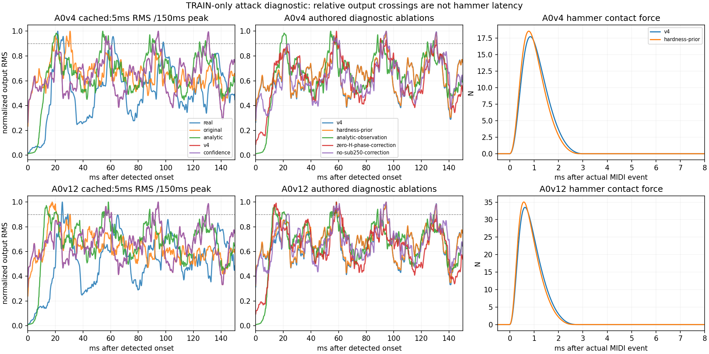

# Full-model attack timing diagnosis

The large A0 rise-time regression is caused by the calibrated pressure
observation changing the relative heights and interference of successive
waveform peaks. It does **not** mean the hammer starts 56 ms late. The attack
waveform still differs substantially from the recordings; changing the onset
finder or optimizing one crossing would conceal that difference.

This diagnostic uses only locked TRAIN recordings: A0/C1/C2/C4 at layers 4 and
12. It fits no parameter, opens no historical evaluation audio or features, and
changes no default. The previously observed historical A0 failure motivated the
question but supplied no numerical target to this experiment.

## Existing controlled evidence

The analytic V4 and final V4 candidates use the same full-model source and exact
physical key fields. At both A0 layers, their force peaks, contact duration,
solve count, residual and final energy match exactly. Only radiation observation
arrays and their enable flag differ. Those observation gains never feed back
into the string/hammer/board mechanics.

| A0 TRAIN layer | Real rise | Original rise | Analytic V4 rise | Final V4 rise | Confidence rise |
|---|---:|---:|---:|---:|---:|
| 4 | 9.104 ms | 19.688 ms | 10.271 ms | 56.167 ms | 56.167 ms |
| 12 | 19.042 ms | 15.188 ms | 5.688 ms | 56.021 ms | 56.021 ms |

The official metric is the 10–90% rise of a centered 5 ms RMS envelope,
relative to its maximum anywhere in the first 150 ms after detected onset.
It is explicitly an output-envelope measure, not a contact duration.

Final V4 and original onsets are identical for both A0 layers. V4's t50 is
actually earlier: 2.396/1.771 ms, versus the original's 2.833/3.479 ms and the
recordings' 16.896/20.062 ms. Centered smoothing spreads model onset energy
backward, so model t10 is zero. These facts rule out a simple shifted launch as
the explanation of the late t90.

The maximum during V4's first 25 ms reaches 84.626%/85.218% of its later maximum.
It would take only 0.535/0.474 dB more amplitude to cross 90%, yet the first
90% crossing moves to the next strong cycle. The final V4 maximum occurs around
94.5 ms. Threshold sensitivity is large:

| A0 TRAIN layer | t80 | t85 | t90 | t95 |
|---|---:|---:|---:|---:|
| 4 | 19.792 ms | 55.958 ms | 56.167 ms | 56.458 ms |
| 12 | 19.562 ms | 20.104 ms | 56.021 ms | 56.250 ms |

Changing RMS smoothing from 1/2/5/10 ms gives V4 layer-4 rises of
20.854/21.104/56.167/53.729 ms and layer-12 rises of
20.812/21.000/56.021/17.750 ms. These are diagnostic sensitivities, not alternate
scores chosen to make the candidate pass. The official measurement is retained.

## Frozen causal probes

Before synthesis, a new protocol pinned 163 source, calibration, recording,
measurement and cached-render inputs. Five variants at the two A0 TRAIN velocity
proxies produced ten 0.35-second renders: 3.5 seconds of new audio in total.
Each note begins at 100 ms and stays held. No gain is fitted to a probe; its
comparison uses the final V4 full-render early-RMS gain.

| Authored diagnostic change | Layer-4 rise | Layer-12 rise |
|---|---:|---:|
| Unmodified V4 | 56.167 ms | 56.021 ms |
| Restore pre-strike-bank hardness 1.0 | 56.104 ms | 55.979 ms |
| Remove additive radiation correction; retain actual board pressure | 10.271 ms | 5.688 ms |
| Zero loaded-board H phase of the additive correction; preserve its magnitude and transformer sign | 56.271 ms | 12.583 ms |
| Remove additive correction below 250 Hz | 56.271 ms | 22.854 ms |

None of these authored observation ablations is a proposed preset. The baseline
and zero-correction outputs match the corresponding frozen full-render prefixes
exactly. Observation variants preserve the complete force/hammer trace and
sampled mechanical checksums. Restoring hardness changes peak force from
17.715/33.516 N to 18.545/35.039 N and shortens contact from 3.000/2.750 ms to
2.875/2.646 ms, while barely changing t90. Thus the selected hardness factor 0.8
is not the main cause of this crossing regression.

Original and V4 A0 velocity exponents are both 0.69. The confidence-prior prompt
loss adjustment also leaves A0 t90 exact. There is no evidence here for fixing
this crossing by a new velocity-response or prompt-loss setting.

Phase or low-frequency removal helps only the stronger layer. Neither supplies
a consistent solution across dynamics. The final pressure combines primary and
secondary modal observations with a board-transient remainder. In the 5–20 ms
window, their coherent sum is 3.112/2.713 dB below the incoherent sum of stem
powers. Relative phase and body cancellation materially affect the attack;
separate stem magnitudes do not describe their combined effect.



The [SVG](../Validation/full-attack-timing.svg) is available for export. Envelope
panels are normalized only to display peak timing; the numerical texture
comparisons retain frozen reference gains. The force panels use the known MIDI
event axis. Real recordings have no known MIDI-event timestamp.

## The actual attack still needs improvement

The later crossing does not mean the beginning lacks energy. With the fixed
scored gain, V4's initial 0–5 ms power exceeds the recordings across all five
analysis bands. In the 250–1000 Hz and 1–4 kHz bands, excesses are
20.7/17.1 dB at layer 4 and 30.0/22.6 dB at layer 12. These very early ratios
are sensitive to the recordings' quiet lead, edited onset and unknown physical
strike timing. They remain explicit diagnostics, not measured hammer-force
errors.

Later struck texture improves despite the rise scalar regression:

| A0 TRAIN layer | Original 5–100 ms band MAE | V4 | Confidence |
|---|---:|---:|---:|
| 4 | 14.772 dB | 7.065 dB | 6.982 dB |
| 12 | 12.344 dB | 6.208 dB | 6.138 dB |

These figures reuse the exact masks and normalization in the frozen official
scores. In the 5–20 ms window, the above-250 Hz spectral centroid is
511/879 Hz for real recordings, 726/1021 Hz for the original, and 616/935 Hz for
V4. At 20–50 ms it is 348/477, 600/769 and 412/653 Hz respectively. The original
and candidate each have timing/texture mismatches; reverting spectral gains to
improve one rise number would discard measured improvements.

The radiation fit uses coherent stem cross terms within its original spectral
windows, but those windows start at 50 ms. It does not directly constrain the
first 0–50 ms pressure shape. A next calibration should preserve actual contact
and body interaction, evaluate early pressure/spectral structure at both
velocities, and retain the later spectrum and envelope checks. This study does
not establish a unique new phase law, a causal radiation replacement, or a
perceptually preferred setting.

## Provenance and limits

- [Frozen diagnostic results](../Validation/full-attack-timing.json)
- [Numerical review, true-event-axis timings and clarifications](../Validation/full-attack-timing-review.json)
- Frozen protocol and producer snapshots: `out/full-attack-timing/`

The state checksum uses the FNV-1a recurrence with a nonstandard offset basis;
its existing `fnv1a64` field means a sampled checksum, not a standard hash or a
collision-proof full-state comparison. It covers modal q/p and hammer x/v/active
at five frames. Exact complete force/hammer traces and the observation-only
source changes provide separate evidence.

The diagnostic raw texture table's prominence mask is normalized by each
window's total band power, unlike the official early-RMS mask. No aggregate
from that diagnostic mask is presented as an official attack error. The MAEs
above come directly from the frozen score masks.

Short ablations let the onset detector inspect 0.35 seconds rather than up to
1.5 seconds. Baseline and analytic onset indices equal the full-render indices;
the review additionally reports all probe t50/t90/peak times relative to the
known 100 ms event. Immediate force follows the frozen original near-string
hammer launch shortcut, not measured finger-to-hammer travel.

Recording room, editing, pedal state, action timing and physical hammer velocity
remain uncertain. No reference waveform enters the synthesizer. This is a
causal numerical diagnostic, not a realtime benchmark or listening verdict.
No candidate is promoted and no detector changes are made.

Authenticate the existing frozen study with:

```sh
python3 tools/probe_full_attack_timing.py verify
OPENBLAS_NUM_THREADS=1 python3 tools/probe_full_attack_timing_review.py
```
