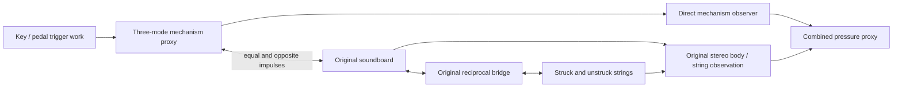

# Mechanical texture sources in the original piano network

This is a bounded research path for inexpensive key press, keybed, key release
and pedal texture. It couples to the **original full physical piano**, including
all 230 strings, both polarizations, 17,778 string modes and 475 soundboard modes.
It does not replace the default plugin DSP or claim a finished action model.

The source is a three-mode mechanical resonator family with four authored
parameter sets. Trigger impulses supply explicit external work. Positive modal
mass, stiffness and damping keep its dynamics passive after a trigger. A
reciprocal viscous port transfers momentum to the piano body, and body motion
reacts back on the source. It is more than an acoustic noise layer.



The musical quality target remains real recordings and listening feedback.
Masses, frequencies, losses, strengths, direct levels and body-port locations
here are authored effective inputs. They are not measured key materials,
felt-contact laws, microphone responses or calibrated pressure levels.
The probe uses a fixed event sequence, not a production MIDI/action integration.
Event hooks should ultimately use the shared key, hammer, pedal and contact
state; adding independent random clicks to every note is not that integration.

## Independently testable boundaries

`physics/MechanismExciter.h` is header-only and contains no original solver
dependency. It has no allocations, locks, I/O or exceptions in trigger/step.
The research-only `tools/mechanism_network_support.h` includes the frozen full
solver with its CLI entry point renamed, using the same convention as the
original independent numerical probes. No canonical solver source is changed.

| Control / export | What it isolates |
|---|---|
| Direct observation mute | Removes the direct audible stem; mechanical state and body reaction remain identical |
| Coupling off | Leaves the source's free mechanical sound while disconnecting body transfer and loading |
| Source off | Removes both the direct sound and the source's passive loading; original output follows its exact original path |
| Intact direct, body and strings stems | Observations of the same complete coupled run, not separate uncoupled renders |
| Source-off difference | Total effect of adding the mechanism to the network, including changed loading |
| Coupling-off network difference | Body/string response caused by the port connection |

An untriggered, enabled source is still attached to the body and can receive
energy from it. Silence at the direct observer is not equivalent to removing a
mechanical load. Disabling a source retires its stored energy explicitly.
States below `1e-24` in energy coordinates are retired with their energy included
in the ledger, avoiding subnormal tails far below audio precision.

## Coupling and work accounting

For source modal coordinates `x=omega sqrt(m) q`, `v=sqrt(m) qdot`,

```text
E_source = .5 sum(x² + v²)
source port velocity = sum(b v)
G_source = sum(b²)
```

The original board uses `E=.5 sum[omega²(q²+p²)]`. Its matching port velocity
and inverse mass are `sum(d omega p)` and `G_body=sum(d²)`. An impulse `J` adds
`d J / omega` to each board `p`. With positive resistance `R` and timestep `h`,

```text
J = h R (v_source-v_body) / [1 + .5 h R (G_source+G_body)]
source impulse = -J, body impulse = +J
relative_mid = (v_source-v_body) - .5 (G_source+G_body) J
delta(E_source+E_body) = -h R relative_mid² <= 0
```

The returned ledger includes actual source energy, body impulse work, internal
loss, coupling loss and tiny-state retirement. Trigger work is recorded
separately. A restrike can supply or extract energy according to the existing
velocity. Output coefficients never enter forces or stored energy.

The frame composition first advances the original piano, then the mechanism
free motions and passive body impulses. The updated body drives strings in the
following original-network step. Its frame-average force `J/h` is included
exactly once in the soundboard acceleration observer without overwriting the
original bridge's force field. This is a first-order split, not a validated
high-order contact/air/action reconstruction.

## Checks, listening exports and benchmark

Build targets staged by root CMake are `keyra_mechanism_network_tests` and
`keyra_mechanism_probe`:

```sh
cmake --build build --target keyra_mechanism_network_tests keyra_mechanism_probe
build/keyra_mechanism_network_tests
build/keyra_mechanism_probe out/mechanism-network/isolated
build/keyra_mechanism_probe out/mechanism-network/with-notes --notes
```

The four test groups exercise free conservation, random source/body energy
identities, reverse body-to-source transfer, observer-only muting, invalid
inputs, allocation traps, source-off exact original output and coupling-off
isolation. Keybed and pedal impulses excite the board and initially unstruck
strings with no note-on or string initial condition. They also check that the
closed, unforced combined network does not gain energy.

Each probe renders an intact run, a coupling-off run and a source-off run with
the same trigger and optional MIDI sequence. The intact direct mechanism,
individual mechanism, raw body, calibrated string-radiation and combined stems
all come from one simulation. A single export gain applies to every stem,
counterfactual and difference. No ablation is independently normalized.
All files use the original 24 Hz output high-pass; no added room is used.
Output levels are diagnostic authored proxies and must not be called acoustic
level calibration or a listener-approved improvement.

The JSON report identifies source energy transfer, work residuals, direct-tail
change caused by body reaction, reconstruction errors and separate CPU scopes.
The isolated timing measures one three-mode component plus a minimal damped
finite-mass body. Whole-network timing includes the expensive original solver,
adapter scans and interval energy diagnostics; it is not an additive component
budget or actual Reason/Jukebox performance.
