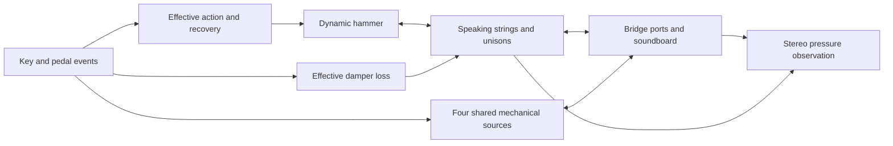

# Piano parts and actual model coverage

This audit uses the supplied grand-action, upright-action, upright-construction
and historical frame diagrams as a connectivity checklist. Engine sources were
checked at `17163b6`. The drawings identify parts and relationships; they do not
identify dimensions, contact laws, material losses or the cause of a recorded
spectral component.

**Full engine** below means `FullInstrument`: the original-control grand or its
explicit frozen confidence build profile. **Research** means a separate
experiment that has not replaced that engine. **Effective** means the behavior
is represented by a parameter, event or reduced state, rather than an explicit
mechanical part. A material entry, preset name or successful numerical test is
not evidence that a pictured part has been physically identified.

The active full-engine network is:

Control arrows and mechanical exchange are shown together here. The separate
research action, cavity, lid and player load are described below rather than
implied to be installed in this network.

## Keys, action and dampers

| Pictured part or interaction | Full engine now | Research coverage and remaining gap |
|---|---|---|
| Finger contacting keytop | Key-press event excites an authored mechanical source. No moving finger or key coordinate. | `Action` has a prescribed moving finger and compliant contact with a dynamic key. Skin/keytop friction and measured finger motion are absent. |
| Key stick, balance/front pins and bushings | Normalized key-lift/recovery state; individual pivots, bushings, friction and key inertia are absent. | One effective key mass, return spring and damping; no individual pin/bushing geometry. |
| Key reaching keybed/cushion | Keybed texture is triggered at admitted hammer launch. It is not a detected bottoming collision. | Explicit compliant bed and loss in `Action`; its direct reaction into the piano body is not connected. |
| Capstan, sticker and wippen | No explicit links. Their transmission is folded into MIDI-to-hammer response and readiness rules. | Fixed lever ratio and reflected hammer inertia, rather than a multi-link action. |
| Jack, jack spring, set-off/escapement | Separation/readiness rules prevent unsafe hammer resets. No moving jack or spring. | An ideal engaged/disengaged jack escapes at a travel threshold. Its spring, friction and individual contacts are absent. |
| Grand repetition lever/double escapement | Partial recovery changes restrike strength/timing and can retain the separated hammer position. No physical repetition lever. | The research jack currently rearms at full rest; it does **not** implement grand double escapement. |
| Backcheck, hammer butt, shank and rail | Nonlinear hammer contact/rebound plus an authored inactive-hammer return proxy. No explicit catch, butt rotation, shank bending or rail collision. | A dissipative threshold backcheck, generic return springs and rest stop. Separate butt/shank dynamics and rail/body radiation remain absent. |
| Hammer head and felt striking strings | Dynamic effective hammer mass; reciprocal nonlinear contact, finite felt footprint, non-adhesive release and bounded speed/hardness variation. | Hereditary felt relaxation, separate felt layers, individual string contact patches and measured voicing are absent. |
| Damper felt, head, lever, spring and spoon | Smoothed key/pedal-dependent damper position changes modal losses. Release texture is an authored source. No moving damper mass or linkage/contact geometry. | The C2/C4 waveguide experiment adds positive damper resistance at the **hammer-contact position**. This is an authored shunt, not the pictured damper location or mechanism. |
| Pedal and rods/linkage | One global continuous sustain control and a body-coupled pedal resonator. | No pedal/rod inertia, joints, travel stops or separately modeled damper tray. |

The full engine's key-press, keybed, release and pedal textures are **four shared
three-mode sources**, not 88 complete actions. They exchange reciprocal impulses
with the soundboard, and their direct observation/body coupling can be isolated.
Their frequencies, levels and trigger timing are authored approximations.

The more detailed `PhysicalInstrument` research path connects hammer contact to
strings, bridge, board and air. It does **not** route the solved finger, keybed or
rail reactions directly into the body. Those connections require compatible
work/reaction ports; adding their forces to audio alone would not close that gap.

Evidence: [full event/coupling path](../src/full_instrument/FullInstrument.cpp#L93),
[repetition gates](../include/keyra/physics/StrikeController.h#L124),
[mechanical sources](../include/keyra/physics/MechanismExciter.h#L8),
[research action equations](../src/physics/Action.cpp#L168),
[research full-rest rearming](../src/physics/Action.cpp#L301),
[research instrument routing](../src/PhysicalInstrument.cpp#L60).

## Strings, bridges and structure

| Pictured part or interaction | Full engine now | What is not separately modeled |
|---|---|---|
| Speaking strings and unison groups | 230 strings, two transverse polarizations, dispersion, detuned unisons, persistent vibration and reciprocal sympathetic coupling. | Longitudinal/phantom components, geometric tension nonlinearity, torsion and winding slip. |
| Copper-wound bass versus plain treble strings | Effective length, linear density, stiffness and losses vary across the keyboard. | Separate core/wrap deformation, packing and friction. Material inventory values are not an identified wound-string model. |
| Bass/treble bridges | Three effective spatial bridge groups couple strings to the board. These are not three literal wooden bridges. | Individual bridge-block motion, glue joints, downbearing/contact geometry and measured maple-bridge impedance. |
| Soundboard, ribs and crown | 475 effective orthotropic plate modes, with authored rib/boundary corrections and stereo radiation observation. | Individual ribs, crown/prestress, glue joints and an identified ribbed/crowned structure. |
| Metal plate/frame, rim, case and keyframe | Fixed/effective boundary and radiation assumptions; no independent component states. | Separate iron-frame, rim, case and keyframe resonances or their mutual junctions. The 475 modes are not a complete frame-and-case model. |
| Pinblock, tuning pins, hitch pins, pressure bar, agraffes/capo | Effective tuning, dispersion and endpoint/port assumptions. | Moving terminations, tuning-pin/pinblock compliance, friction/slip and non-speaking string lengths. |
| Duplex/afterlength segments | No identified duplex or afterlength network. | The waveguide's left/outbound/inbound paths divide the **speaking** string; they are not duplex strings. The isolated C8 auxiliary-resonator experiment does not establish a duplex identity. |
| Lid, enclosed air and seated player | No explicit cavity/lid/player load in the default full API. | A separate reciprocal full-model adapter demonstrates one cavity/aperture mode, static lid geometry and positive player loading. Flexible lid motion, detailed scattering and a three-dimensional air field remain absent. |
| Microphones | Two pressure observations with calibrated modal weighting and adjustable width. | Measured microphone capsules, exact placement/propagation and a calibrated set of alternative mic combinations. Other arrangements in the reduced preview are authored approximations. |

Evidence: [strings and effective geometry](../src/full_instrument/PreparedModel.h#L253),
[board and radiation](../src/full_instrument/PreparedModel.h#L368),
[reciprocal full-model air experiment](FULL_ACOUSTIC_NETWORK.md),
[waveguide scope](COUPLED_WAVEGUIDE.md), [unassigned auxiliary resonance](LOCAL_RESONANCE.md).

The separate 48-mode material plate uses Sitka/Norway spruce bulk properties.
Selecting the copied 475-mode reference board does not identify those modes as
either species. Maple bridge, music wire, copper, key-wood and keytop entries
provide evidence/priors; they do not mean all those materials are switchable
parts of the full engine. See [MATERIALS.md](MATERIALS.md).

## Grand and upright are distinct mechanisms

There is currently no dedicated upright action in the full physical engine.
The additional reduced preview has an upright recording calibration, but that
does not model the pictured sticker/wippen, hammer butt, return springs or
damper spoon. A grand's repetition mechanism and an upright's return/reset
mechanism need different states and timing assumptions.

The full API currently has sustain only. The retained `Source/DSP/KeyraEngine`
frontend has soft pedal, sostenuto and mod-wheel damping, but those features
must not be attributed to `FullInstrument`. Nor is a soft-pedal voicing change
the same as simulating a grand action shift or an upright hammer-rail movement.
The upright's muffler felt/practice rail is another distinct mechanism; it is
not a synonym for sostenuto.

Evidence: [full public controls](../include/keyra/FullInstrument.h#L16),
[retained frontend pedals](../../Source/DSP/KeyraEngine.cpp#L292),
[reduced upright basis](../src/Piano.cpp#L98).

## Priorities from this map

1. Resolve the audible original attack click against recordings and intact
   pressure stems. It is present with the added mechanical sources disabled;
   the diagrams alone do not identify its physical source.
2. Unify effective key/hammer/jack/backcheck/repetition behavior, preserving the
   current vibrating-string state and safe partial-return strikes. Define MIDI
   event timing before introducing finger-to-strike travel latency.
3. Connect bed, catch, rail and damper reactions to body ports with explicit
   work accounting, then give grand and upright their correct return mechanisms.
4. Add termination, case/frame or acoustic detail where measurements and
   listening show a useful effect. Fit effective boundary impedances before
   committing CPU to every illustrated structural member.

Reduced action states and passive ports are appropriate when they preserve the
measured timing, losses and transfer. Geometry detail should earn its CPU cost
through audible or behavioral improvements.

Each new interaction needs an isolated fixture, a connected-network witness and
source/coupling ablations. Numerical stability and a part's presence do not
establish acoustic realism. Existing fixtures are indexed in
[MODULES.md](MODULES.md), [ACTION_MODEL.md](ACTION_MODEL.md) and
[FULL_BACKEND.md](FULL_BACKEND.md). This audit changes no DSP or default sound.
