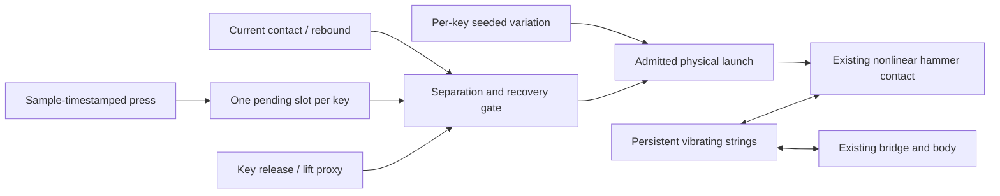

# Stateful strike variation and repetition

This research adapter adds bounded excitation variation and a repetition/return
controller to the original full piano. It keeps all 88 keys, 230 strings,
17,778 string modes, 475 board modes, nonlinear contact and reciprocal coupling.
The canonical full solver and calibration are unchanged. This is not yet the
default plugin backend or a measured reconstruction of a piano action.

## What changes on a press

`physics/StrikeController.h` owns fixed per-key event/recovery state, separate
from string and body state. Each request draws new per-key correlated velocity
and hardness variation. The default amount is 0.65, with configured full-scale
bounds of ±0.8% hammer velocity and ±2.5% contact stiffness. The actual default
bounds are therefore ±0.52% and ±1.625%. An amount of zero provides a control.
There is no global pitch change, oscillator-phase reset or string retuning.
Per-key RNG state means another key does not perturb that key's variation
sequence. A reset controller plus fresh physical state, the same seed and
sample-timestamped inputs reproduces the same performance; successive admitted
strikes within a performance consume new
variation. These are authored ranges, not measured player/felt distributions.

The adapter never clears string `q`/`p` state on a press. A fresh force therefore
meets the current vibration phase and nonlinear contact response. Hardness and
launch velocity are changed only at a separated, inactive hammer, where contact
potential is zero. A request during inbound travel or contact leaves the
existing hammer position, velocity and hardness untouched.



## Repetition and release policy

The original convenience `noteOn` always places a hammer near its string and
overwrites its velocity; an inactive hammer then freezes. The adapter adds an
explicit, inexpensive return/key-lift proxy instead of using that reset during
every repeated note.

- A safe strike requires an inactive hammer, at least 0.5 mm separation after
  the first launch, a minimum 3 ms interval and sufficient authored recovery.
- Unused hammers start 12 mm behind the initially resting string plane, matching
  the controller's authored rest depth. Existing body or string vibration must
  not falsely make a virgin hammer appear compressed or delay its first launch.
- An explicit key release must lift at least 20% of the effective key travel
  before a new strike is admitted. A new press with an insufficient release
  completes that lift over finite time while pending, then resumes depression.
  From a fully depressed key this takes about 4 ms with the authored 18 ms
  release time constant; it does not instantly restore a full key or hammer.
  This supports touching quantized MIDI notes without permanently latching the
  pending lift at zero. Release restores readiness independently of the sustain
  pedal. The pedal changes the original dampers, not the repetition proxy.
- Partial recovery reduces launch speed and preserves the separated hammer's
  current position. It does not jump an in-flight hammer toward the string.
- The return proxy has 12 ms released / 35 ms held exponential time constants,
  with an 18 ms key-lift and 5 ms depression proxy. These are effective authored
  timing choices, not measured escapement/backcheck geometry.
- A fully ready strike uses the original near-string MIDI launch shortcut.
  Full finger/key travel latency is omitted. Partial strikes retain their travel
  distance and may consequently start later.
- Repeated note-on without note-off is treated explicitly as a short implicit
  key cycle. Its effective lift has a 0.35 floor, not a full reset. An explicit
  but insufficient release uses the finite lift completion above instead of
  that shortcut. Completing key lift never bypasses active-contact, separation,
  minimum-interval or hammer-recovery gates.
- Each key has **one** pending slot. A new request replaces the previous pending
  request and increments the coalescing counter. Note-off cancels an unlaunched
  request. A request that never becomes safe expires after 120 ms.
- If the original solver's 40 ms safety retirement occurs before separation,
  its discarded hammer energy is recorded and a diagnosed, finite-speed return
  proxy starts at the signed retired depth. New strikes remain blocked until
  separation; this prevents a permanently unready key without resetting an
  active hammer or contact. The original retirement itself is not a physical
  action mechanism.
- MIDI note-on velocity zero acts as note-off; invalid/nonfinite events are
  rejected. The original raw `grand::noteOn` does not itself implement that MIDI
  convention, so the adapter handles it before entering the solver.

Input requests retain their sample timestamps. The actual hammer launches can
be deferred, coalesced or cancelled; this is physical scheduling, not a claim
of sample-exact audible retriggering. High-rate machine-gun input can request
more strikes than this action proxy admits. The diagnostic counters expose it.

The inactive return position/velocity are a kinematic proxy outside the original
solver's active-hammer energy. A complete jack, key inertia, backcheck and felt
memory model is not implied. The independently tested `physics/Action` path
provides a separate, more detailed action experiment.

## Energy and module boundaries

`tools/strike_repetition_support.h` is a research-only adapter, reusing the
original full-model include convention. Its event path changes damper state,
pending state and safe hammer excitation, with no new allocation or I/O.
The original solver can still throw on exceptional numerical failures; this
adapter is not a finished exception-free Jukebox implementation.

At admission, the string/body state is unchanged and the new compression is
negative. The added original-network energy is exactly the new hammer kinetic
energy `m v²/2`; the launch ledger records it. Original active-hammer retirement
is also recorded when it occurs. Replaced inactive velocity has a separate
kinematic-energy diagnostic because the original network already excludes that
inactive hammer. It must not be subtracted twice from network energy.

This is an explicit launch/retirement ledger, not a complete conservation audit
of all original contact, damper and radiative losses.

Optional existing key/pedal mechanism resonators consume the same accepted
events and exchange energy with the original body. Key press is observed at
request time; keybed is currently triggered at the admitted strike as a timing
proxy. That does not imply a measured keybed collision. Source-strength
variation follows the same strike factors, and duplicate note-offs do not
create extra release clicks.

## Checks and probe

Root CMake can stage `keyra_strike_repetition_tests` and `keyra_strike_probe`
from the same-named test/probe files, with include directory `include`, C++17
and floating-point contraction disabled. No `keyra_physical` link is required.

```sh
g++ -O3 -DNDEBUG -std=c++17 -ffp-contract=off -Iinclude \
  tests/strike_repetition_tests.cpp -o out/strike-repetition/v3/tests
out/strike-repetition/v3/tests
g++ -O3 -DNDEBUG -std=c++17 -ffp-contract=off -Iinclude \
  tools/probe_strike_repetition.cpp -o out/strike-repetition/v3/probe
out/strike-repetition/v3/probe out/strike-repetition/v3/repetitions
```

The eight groups check variation bounds, seed/key independence, queue coalescing
and cancellation, partial/full return, velocity-zero release, no active-hammer
teleport, bit-identical string state at press events, launch-work identity,
distinct same-velocity isolated-ready audio, finite 5/20/80 ms repetition,
allocation traps and sample/partition reproducibility. Touching MIDI notes and
1-frame/1 ms releases complete a finite lift instead of remaining unready;
cancellation during lift and active-hammer coalescing are checked separately.
The virgin-hammer
regression covers both signs of existing string displacement, all 88 initial
rest positions, and real pedal-to-body-to-unstruck-string excitation before the
first strike.

The probe exports legacy reset, recovery control, varied recovery and optional
body-coupled-mechanism outputs with one shared sample-peak gain. Every version
uses the same MIDI sequence, the original 24 Hz high-pass and no added room.
Launch timestamps, request IDs, recovery, variation factors and input-event
counters remain visible in its JSON. Audio and parameters are diagnostic,
not a listener-approved realism result. Whole-model timing includes the
expensive original solver; the separate controller-only benchmark has a
synthetic hammer observation and does not establish actual Reason performance.

The current probe/listening export uses `out/strike-repetition/v3`. All three
controlled versions admit six of seven requests, including the 15 ms
partial-recovery request; the remaining request is cancelled. The finite lift
cycle fixes the earlier rejection of this short explicit release/repress.
Versions 1 and 2 are preserved unchanged with their original sources, audio and
receipts; their older launch counts remain historical evidence.

Version 1 is
preserved byte-for-byte under `out/strike-repetition/v1`, with source snapshots,
producer binaries, reports, WAV/FLAC audio and an archive receipt. Its unused
hammers incorrectly started on the contact plane; body motion could therefore
delay the first strike. A regression built against that old adapter fails at
the expected vibrating-string gate. Version 1's original hashes are retained;
it is superseded evidence, not a valid first-strike timing reference.
