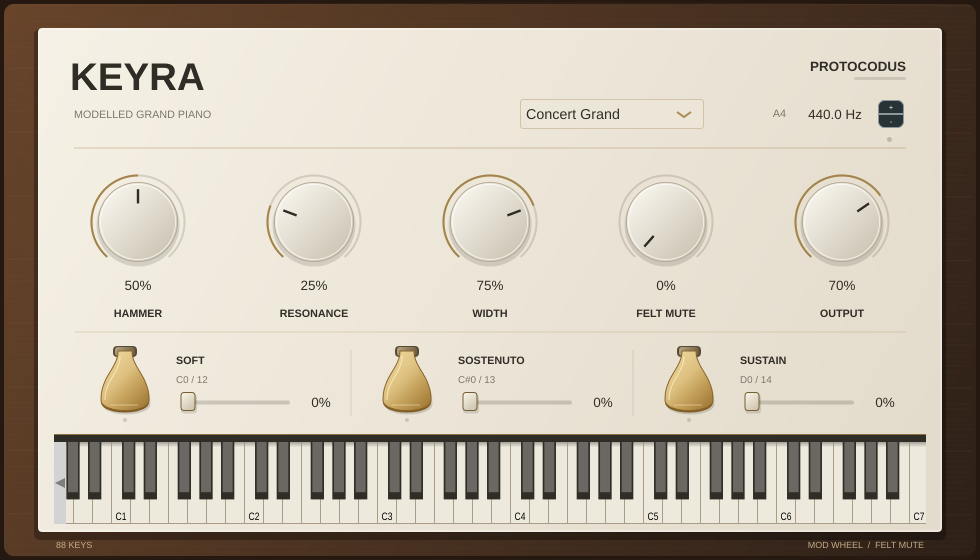

# Keyra

Keyra is a sample-free, 88-key piano instrument in development. It now has a real-time reduced modal core, a VST3/standalone wrapper, continuous sustain, sostenuto and soft pedals, and smooth mod-wheel felt muting. A wood-and-ivory Reason Rack Extension adapter lives in the [Rack repository](https://github.com/protocodus/reason-rack-extensions/tree/codex/keyra-rack/Examples/Keyra).



## Current development candidate — 0.2.0

The live engine generates detuned modal unisons with positive prompt/late decay components and a reduced sympathetic response. Its numeric calibration is derived from ten acoustic recording cases; it loads no recorded waveform or impulse response. The original nonlinear reference below is preserved as a separate implementation.

The [current recording benchmark](Docs/validation/recording-benchmark-2026-10-26.md) reports training, twelve excluded in-range cases and two extreme notes, including regressions. The [iteration record](Docs/research/recording-iteration-2026-10-26.md) explains the fitting method and validation reuse. Neither isolated-note agreement nor a successful native build establishes commercial readiness or a price above USD 199. See the [production gates](Docs/plans/production-readiness.md).

| Mean error on the twelve development-validation cases | Offline reference | Live default |
|---|---:|---:|
| Harmonic levels | 4.96 dB | 3.82 dB |
| Attack rise | 19.17 ms | 7.23 ms |
| Amplitude envelope | 4.30 dB | 4.40 dB |
| Broad spectral bands | 12.09 dB | 12.27 dB |

The first two improve; the latter two regress. Those twelve results informed the model's development. A [fresh eight-pitch test](Docs/validation/recording-benchmark-fresh-2026-10-26.md), locked before downloading its recordings, gives 6.97 dB harmonic error and 6.98 ms attack error at the product defaults. All recordings come from the same piano/session.

Listen to the current live engine: [Nocturne](Docs/audio/live/01_nocturne.mp3), [Jazz waltz](Docs/audio/live/03_jazz_waltz.mp3), and [pedals and mod-wheel study](Docs/audio/live/pedal-study.mp3). No additional room effect or normalization is applied. Sighted, level-matched comparisons play real recording → first live model → refit live model: [C4](Docs/audio/recording-comparisons/2026-10-26/C4v8-real-initial-refit.mp3), [F♯3](Docs/audio/recording-comparisons/2026-10-26/Fsharp3v8-real-initial-refit.mp3), [C6](Docs/audio/recording-comparisons/2026-10-26/C6v8-real-initial-refit.mp3). See their [level matching and attribution](Docs/audio/recording-comparisons/2026-10-26/README.md).

| MIDI | Playing behavior |
|---|---|
| CC64 | Continuous sustain, half-pedal damping and repedaling |
| CC66 | Sostenuto captures keys held at its rising edge |
| CC67 | Soft pedal changes subsequent strike excitation |
| CC1 | Smooth felt damping, including held keys |

The DAW interface provides nine automatable controls, five authored timbre presets, concert tuning, stereo width and a playable keyboard. State recall and sample-offset MIDI dispatch have native wrapper tests. The Rack adapter consumes the same canonical engine and adds Reason note-state, performance-property and note/gate CV adaptation. Read the [user guide](Docs/guide/user-guide.md) for controller and panel interaction.

Three visible brass pedals show live travel. Below-keyboard momentary keyswitches assign **MIDI 12 / C0 to soft**, **13 / C♯0 to sostenuto**, and **14 / D0 to sustain** (middle C = C4). Press and hold to engage; release to lift. They sit below the piano's A0 and never sound a string. MIDI note numbers remain the reliable identifiers in DAWs with different octave names.

## Build the live instrument

The core and renderer need CMake and a C++17 compiler:

```sh
cmake -S . -B build -DCMAKE_BUILD_TYPE=Release
cmake --build build -j
ctest --test-dir build --output-on-failure
build/keyra_render --help
```

The optional DAW wrapper uses JUCE 8.0.14, pinned to a commit. Supply a local checkout with `KEYRA_JUCE_PATH` or let CMake fetch it. Linux additionally needs ALSA, FreeType, fontconfig, X11/Xext/Xinerama/Xrandr/Xcursor and OpenGL development packages.

```sh
cmake -S . -B build-plugin -DCMAKE_BUILD_TYPE=Release \
  -DKEYRA_BUILD_PLUGIN=ON -DKEYRA_JUCE_PATH=/path/to/JUCE
cmake --build build-plugin --target Keyra_VST3 Keyra_Standalone -j
ctest --test-dir build-plugin --output-on-failure
```

VST3 and standalone are configured on desktop platforms; AU is also configured on macOS. Platform configuration is not a claim that every platform has been built or host-tested. The Reason `.u45` requires the developer-supplied Jukebox SDK and Reason acceptance; the source wrapper alone is not a release artifact. JUCE and recording attribution are in [THIRD_PARTY_NOTICES.md](THIRD_PARTY_NOTICES.md).

## Preserved offline reference

The offline reference models nonlinear hammer contact, dispersive two-polarization strings, detuned unisons, sympathetic coupling and a reduced soundboard. It has 88 keys, 230 strings, 17,778 string modes and 475 board modes. Numeric calibration comes from acoustic-piano measurements; no recorded waveform or impulse response is loaded by the synthesizer.

The reference renderer is expensive: the supplied 192 kHz musical renders took about 17–19 wall seconds per audio second on the original development machine. The benchmark and musical examples below apply to this preserved renderer, not to the new live core.

## Reference sound and evidence

[Research/GrandPianoV2](Research/GrandPianoV2/README.md) preserves the exact v2 solver and calibration, original event/MIDI scores, measurement scripts, frozen reports and numerical validation. The source import is documented in [import-provenance.json](Research/GrandPianoV2/import-provenance.json).

| Original musical example | MP3 preview |
|---|---|
| Window at Dusk | [Nocturne](Research/GrandPianoV2/renders/01_nocturne-room.mp3) |
| Two Voices in Morning Light | [Prelude](Research/GrandPianoV2/renders/02_prelude-room.mp3) |
| Sunday on the River | [Jazz waltz](Research/GrandPianoV2/renders/03_jazz_waltz-room.mp3) |
| Copper and Thunder | [Etude](Research/GrandPianoV2/renders/04_etude-room.mp3) |

The isolated-note clips play **real acoustic piano → original POC → calibrated v2**. Try [C4](Research/GrandPianoV2/listening/C4v8-real-v1-v2.mp3), [F♯3](Research/GrandPianoV2/listening/Fsharp3v8-real-v1-v2.mp3) or the [C7 extrapolation check](Research/GrandPianoV2/listening/C7v8-real-v1-v2.mp3). These are level-matched, labeled comparisons, not blind listening tests.

The reference recordings are **Salamander Grand Piano V3 by Alexander Holm**, an acoustic Yamaha C5 set under CC BY 3.0. Ten notes/velocity cases were used for fitting, twelve in-range cases were excluded from fitting and two extreme notes were tested separately. Across the twelve in-range held-out cases:

| Mean error — lower is better | Original POC | Calibrated reference |
|---|---:|---:|
| Harmonic levels | 11.03 dB | 4.96 dB |
| Broad spectral bands | 15.62 dB | 12.09 dB |
| Partial decay rate | 3.88 dB/s | 2.83 dB/s |
| Attack rise time | 8.29 ms | 19.17 ms |

Attack timing regressed. All four held-out-pitch envelope errors and several upper-register/edge cases also regressed. The [complete benchmark](Research/GrandPianoV2/BENCHMARK.md) includes every case and limitation; error reductions are not percentages of perceptual realism or a claim of Pianoteq parity.

## Build the preserved reference

The reference engine needs a C++17 compiler and CMake. It has no SDK dependency.

```sh
cmake -S . -B build -DCMAKE_BUILD_TYPE=Release
cmake --build build -j
ctest --test-dir build --output-on-failure
build/keyra_reference --help
```

To regenerate the musical WAVs and MP3s:

```sh
cd Research/GrandPianoV2
python3 -m pip install -r requirements.txt
python3 tools/render.py --jobs 4
python3 tools/validate.py --audio
```

`ffmpeg` is required for MP3 encoding and reference decoding. Matplotlib is optional for regenerating figures. The [reference README](Research/GrandPianoV2/README.md) documents MIDI import, benchmark reproduction and generated assets.

## Source and licensing boundaries

- [Research/GrandPianoV2/src](Research/GrandPianoV2/src/): preserved offline solver and generated numeric calibration.
- `Source/DSP/` owns the current live engine and its generated numeric modal data; `Source/Plugin*` owns the DAW wrapper.
- The proprietary Jukebox SDK is not included. The thin Rack adapter is maintained separately and compiles this canonical engine directly.
- Reference-audio attribution and modification details are in [ATTRIBUTION.md](Research/GrandPianoV2/reference/ATTRIBUTION.md), with the [full CC BY 3.0 license](Research/GrandPianoV2/reference/upstream/LICENSE-CC-BY-3.0.txt).

This checkout includes small MP3 examples and numerical evidence. Original reference FLACs, decoded WAVs, full-resolution demo WAVs and compiled binaries are intentionally generated or fetched instead of tracked. The source code has no additional open-source license grant; the audio's CC BY license does not license the implementation.
