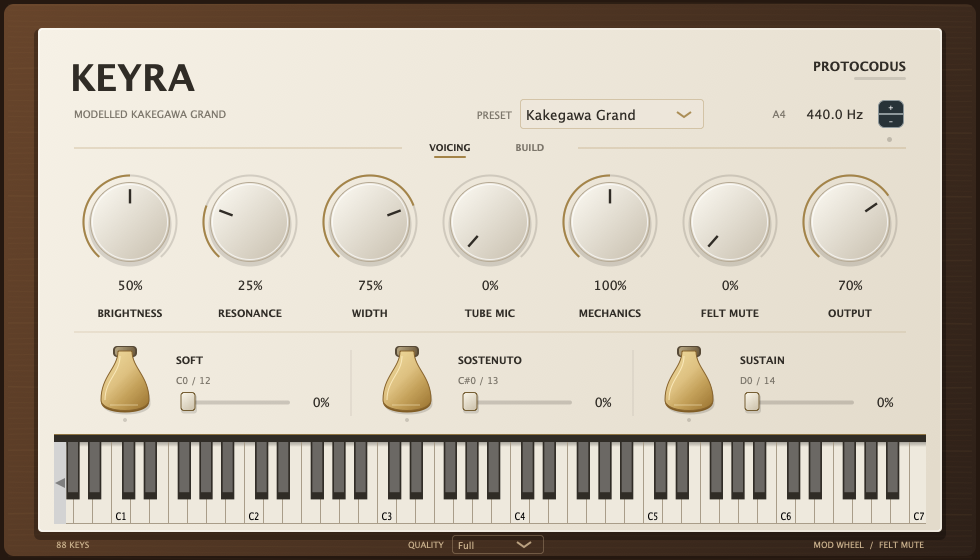

# Keyra

Keyra is a sample-free piano, a grand or an upright: a real-time modal engine
whose strings, soundboard ring and stereo image are fitted from numerical
measurements of acoustic piano recordings, with three visible pedals,
momentary pedal keyswitches and felt muting from the modulation wheel. It
builds as VST3 and CLAP plug-ins, an Audio Unit on macOS and a standalone
application, and the Reason Rack Extension adapter plays the same engine's
grand. It is a development candidate: host acceptance and a commercial release
are still to come.



## Audio demos

One phrase per factory preset, written for what that preset is for and
rendered from `Docs/audio/midi/` through the shipping engine.

<!-- audio-demos-begin -->

| # | Preset | Demo | Length | Peak |
| --- | --- | --- | --- | --- |
| 1 | Concert Grand | [01-concert-grand.wav](Docs/audio/01-concert-grand.wav) | 11.2 s | -1.5 dBFS |
| 2 | Studio Grand | [02-studio-grand.wav](Docs/audio/02-studio-grand.wav) | 11.6 s | -5.8 dBFS |
| 3 | Warm Walnut | [03-warm-walnut.wav](Docs/audio/03-warm-walnut.wav) | 11.1 s | -12.1 dBFS |
| 4 | Felt Nocturne | [04-felt-nocturne.wav](Docs/audio/04-felt-nocturne.wav) | 10.7 s | -14.9 dBFS |
| 5 | Open Strings | [05-open-strings.wav](Docs/audio/05-open-strings.wav) | 11.7 s | -1.5 dBFS |
| 6 | Rehearsal Upright | [06-rehearsal-upright.wav](Docs/audio/06-rehearsal-upright.wav) | 11.6 s | -2.7 dBFS |
| 7 | Felt Upright | [07-felt-upright.wav](Docs/audio/07-felt-upright.wav) | 10.4 s | -8.1 dBFS |
| 8 | Pop Upright | [08-pop-upright.wav](Docs/audio/08-pop-upright.wav) | 11.6 s | -1.5 dBFS |

<!-- audio-demos-end -->

### Listening against the recordings

The [recording comparisons](Docs/audio/recording-comparisons/2026-10-26/README.md)
play a real Salamander Grand note, the first fit and the current fit in turn,
level-matched. The [live renders](Docs/audio/live/manifest.json) are earlier
musical passages through the same engine. Both are frozen evidence from
0.2.0's review.

## Version history

### Unreleased — 0.4.1 — measured strings, body and board noise

- Recalibrated from 264 recordings (every A, C and F♯ from A0 to A7 at twelve
  velocities) instead of ten. Each partial has four measured decay lanes with
  their own beating and left/right balance, starts from the phase pattern the
  recordings show at string contact and rises no faster than its pitch's
  recorded onset.
- Every strike knocks a body of 91 measured soundboard and case modes and
  starts a burst of board noise in 13 bands, measured for its pitch, so
  repeated notes differ as real strikes do. The felt mute damps the strings,
  not this ring, which dies within a second. The knock grows about decibel
  for decibel with the level the strike's layer plays at, as the
  recordings' does: soft notes knocked the body 5 to 6 dB louder than
  theirs, and now about 1 dB, which brings the attack spectrum 0.1 dB
  (grand) and 0.4 dB (upright) closer to the calibration notes
  ([grand](Docs/validation/grand-knock-benchmark-2026-10-29.md),
  [upright](Docs/validation/upright-knock-benchmark-2026-10-29.md)). Under a
  top note's fundamental the noise is measured past the other strings' tones
  there, which it used to take for noise ringing on, so the upright's top
  octave no longer leaves a hiss ringing for seconds
  ([grand](Docs/validation/grand-treble-noise-benchmark-2026-10-29.md),
  [upright](Docs/validation/upright-treble-noise-benchmark-2026-10-29.md)).
- Both pianos answer velocity alike, at the owner's request: a velocity asks
  for a level under the loudest recorded layer, halfway between a straight
  line and an S-curve, and plays the layer coordinate where that piano's
  recordings reach it, so its tone is the one recorded at that loudness.
  Velocity 127 plays each piano's loudest layer, which it used to play past,
  and velocity 1 the grand's softest, 21 dB under it. The two pianos' median
  notes now sit within 1 dB of each other at every velocity, where the
  upright's sat up to 10 dB under the grand's, and from velocity 64 to 127
  the median key grows 10.6 dB on the grand and 9.9 dB on the upright (it
  grew 8.4 and 17.4). The upright's softest layer, 6 dB further under its
  loudest than the grand's, no longer plays on its own.
- No two strikes land alike: each plays a little harder or softer than its
  velocity, as a player's do, by the spread the upright library's new
  second strikes measure, 1.085 dB of level on every key, the harder one
  the brighter. Repeated chords change level and colour from strike to
  strike; tuning does not, as those strikes keep their pitch within
  0.02 cents.
- Both pianos play 11.5 dB louder, at the level of the portfolio's newer
  instruments: typical playing on the default controls reads −9 VU on
  Reason's channel meter at the default Output. The portfolio's shared output
  stage replaces the clip at full scale: its guard keeps the loudest chords
  out of the red and its look-ahead limiter every sample under −1.5 dBFS,
  for 2 ms of latency, which the plug-in reports. Single notes pass it
  untouched; it takes a median 1.4 dB from the grand's chords at velocity
  110 and 3 dB from the upright's. The felt presets read about 8 dB lower
  (below).
- A Quality choice trades detail for CPU on slower machines, at the owner's
  request. Full, the default, plays every partial; Balanced and Light leave
  out a strike's partials and components 60 and 50 dB under its strongest,
  which moves no third-octave band of a note by more than 0.04 and 0.74 dB.
  Legato chords under the pedal take 49 and 38 % of Full's CPU on the
  grand; the upright, which plays fewer partials, saves up to 13 %. Quality
  stays with the session, not the preset.
- Beside its partials, a strike plays the components the recordings hold
  between them, 48 at A0 and a few or none from C4 up, and sets ringing every
  undamped string from F6 up but its own key's, each at its own measured
  pitch, decay and stereo position, at the level the recorded pitches around
  the key set it. They ring on after the key is let go. Each starts with its
  own prompt part, which a struck unison sounds before its aftersound and the
  bridge drains within a few tenths of a second: in their first quarter
  second the strings that ring clear sit a median 2 to 4 dB under the grand's
  recordings, where they sat 5 to 8 dB under, and 2 to 8 dB under the
  upright's, where they sat 5 to 11 dB under.
- A key between two recorded pitches plays about as loud as they do. Its
  partials' lanes were blended one by one and, with offsets, phases and
  stereo pickups neither pitch has, beat and cancelled where neither pitch's
  do: the grand's B4 sat about 4 dB under both its neighbours and the
  upright's B3 3 to 4.7 dB. Each blended partial's power over its first second
  now sits between the two pitches' in dB. At five velocities no key plays
  more than 2.8 dB outside the levels of the recorded pitches around it, and
  at most 4 of the grand's 63 such keys and 5 of the upright's 52 more than
  1 dB, where up to 16 and 18 did. The grand's never-fitted D♯ pitches sit up
  to 0.8 dB closer to their recordings' level; the upright's recordings are
  less even from note to note, and four of its five never-fitted pitches sit
  0.3 to 0.9 dB further from theirs
  ([grand](Docs/validation/grand-between-pitches-benchmark-2026-10-28.md),
  [upright](Docs/validation/upright-between-pitches-benchmark-2026-10-28.md)).
- Letting a key go knocks the body as its damper lands, and the sustain pedal
  knocks it going down and coming up, synthesized on the body's modes: each
  mode's level and phase is measured from the library's release and pedal
  recordings, and the knocks sit against the notes as the library's SFZ mixes
  them, since the recordings carry no level of their own.
- Existing sessions sound different. On the 156 never-fitted cases of the
  [recording benchmark](Docs/validation/grand-recording-benchmark-2026-10-29.md),
  partial levels sit 3.1 dB from the recordings (0.3.0: 9.8 dB), the attack
  spectrum 4.2 dB (15.8 dB), the sustain spectrum 4.6 dB (10.2 dB) and the
  noise between partials 6.3 dB (24.7 dB); its regressions, C4's and F♯4's
  onset rise first, are listed there.
- Adds an upright beside the grand, chosen with the new Piano control and
  three presets (Rehearsal Upright, Felt Upright, Pop Upright): a 1967
  upright with worn hammers in a dry room, measured the grand's way from 137
  recordings of the Helsinki 1967 Tube-Ribbon Edition (Mikko Patama, with his
  permission; none of its recordings is distributed). Switching silences what
  sounds; sessions saved before keep the grand. On the
  [upright's benchmark](Docs/validation/upright-recording-benchmark-2026-10-28.md)
  its attack, tuning and level sit closer to its never-fitted recordings than
  the grand's data does; its treble does not yet (Known gaps). From C6 up its
  unison strings sound up to 20 cents from their partial: its first fit took
  those beyond the partial's lanes, which reached about 3 cents, for the
  partial's own and left them out, so its treble tails fell too fast. The
  lanes now reach about 10 cents where the recordings hold strings that far
  out, and the strings beyond them play beside the partials. On the
  never-fitted E6 the partials sit 6.8 dB from the recordings instead of 8.9,
  their decay 8.2 dB/s instead of 13.9 and the sustain spectrum 10.1 dB
  instead of 15.1 ([unisons](Docs/validation/upright-unison-benchmark-2026-10-28.md),
  [reach](Docs/validation/upright-lane-reach-benchmark-2026-10-28.md)). The
  grand's lanes reach as far: its never-fitted treble's decay sits 3.3 dB/s
  from the recordings instead of 4.5, and F♯6's envelope 5.3 dB instead of
  2.2 ([grand](Docs/validation/grand-lane-reach-benchmark-2026-10-28.md)).
  Its dampers leave ringing what the library's key-release takes show, a
  share of each partial that fades over seconds once the felt lands, 13 dB
  down at middle C and less higher up: on the never-fitted takes its
  releases sit 6.3 dB from the recordings, where the grand's felt left them
  8.4 dB ([release benchmark](Docs/validation/upright-release-benchmark-2026-10-28.md)).
- Adds the CLAP plug-in on every platform beside VST3, the standalone
  application and, on macOS, the Audio Unit.
- The repository root is the product only. The full physical piano research
  moved to [`Experiments/`](Experiments/README.md), its own CMake project that
  the product build does not build.

### 0.2.0 — 2026-10-26 — native instrument

- The real-time modal piano with five presets, three visible pedals,
  momentary pedal keyswitches on MIDI 12–14, continuous pedal depth and
  modulation-wheel felt muting, as a VST3 plug-in and a standalone
  application. Details are in the
  [native wrapper validation](Docs/validation/native-wrapper-2026-10-26.md).

## Downloads

<!-- build-download-begin -->
**[Download main build 15](https://github.com/protocodus/virtual-instrument-keyra/actions/runs/40806970420/artifacts/12868419849)**, built from [`bd1127756ad1`](https://github.com/protocodus/virtual-instrument-keyra/commit/bd1127756ad1fc7356172ab24240ecad67032d38). It holds the macOS, Windows and Linux packages, `SHA256SUMS` and `BUILD.txt`.
<!-- build-download-end -->

---

## How it works

### The modal engine

`Source/DSP/KeyraEngine` is front-end-neutral C++17 with no allocation, I/O or
locks in its event and render calls; the plug-in and the Rack adapter both
compile it. Each struck key becomes one voice of up to 128 stiff-string
partials (128 voices; when they run out, a released tail goes before the
oldest held note). Every partial has four lanes, each a decaying rotation with
its own rate, small frequency offset and stereo pickup: together they make a
note's prompt fall, the beating of its unison strings, its slow aftersound and
the way its balance moves between the microphones. A partial starts from the
phase the recordings show at string contact and rises from zero, never faster
than its pitch's recorded onset builds up. The lanes run four to a 128-bit
vector in single precision, restarted every 32 samples from a double-precision
state, so long notes keep their exact decay.

Both pianos answer velocity alike. A strike plays at a coordinate between
its piano's recorded layers, each layer at the velocity its library maps to
it: a velocity asks for a level under the loudest layer, halfway between a
straight line and smoothstep from velocity 1 to 127, and the strike plays
where the piano's layers reach that level, so its tone is the one recorded
at that loudness. A layer's level is its early level under the same pitch's
loudest layer (both channels' RMS from 50 to 750 ms after the onset), the
median over the pitches recorded at every layer. Velocity 127 plays each
piano's loudest layer, and velocity 1 the grand's softest, 21.2 dB under it,
which the upright reaches between its two softest layers. Single keys keep
their recordings' differences: at one velocity a key of the upright sits
from 4 dB under to 7 dB over the same key of the grand (the tenth to the
ninetieth percentile), where the two pianos' median notes sit within 1 dB.

No two strikes land alike. Each plays a little harder or softer than its
velocity asks: its level moves by a random amount with a spread of 1.085 dB,
which the upright library's new second strikes measure (below), and it plays
the layer coordinate at that level, so a repeated chord changes level and
colour from strike to strike, and keeps its tuning. A spread in velocity
units instead would follow each layer's level slope, which at the upright's
loudest layers is twice the measured layers', and so double it there. The
draws restart with the engine, so a render replays exactly.

Beside its series, a strike plays the components the recordings hold between
the partials, each one lane placed by the series and damped with it; in the
treble they include the unison strings that sound further from their partial
than its lanes reach. They
start at contact under the pitch's onset rise and share vectors four lanes to
a slot, so a component costs a quarter of a partial.

Every strike also knocks the body: a bank of 91 soundboard and case modes from
29 to 945 Hz, shared by every key, which rings for half a second to a second,
with the level and phase measured for each recorded pitch; the knock grows
about decibel for decibel with the level the strike's layer plays at.
Above the modes, the board's dense ring is band noise in 13 third-octave bands
from 1 to 16 kHz, each a sixth-order band-pass so that the quiet top octaves
keep their measured level: each strike starts its own burst with the density,
decay and left/right balance measured for its pitch. A shared bank of 88 open-string
resonators supplies the sympathetic response the Resonance control sets. Its
top twenty are the undamped strings from F6 up, which every strike sets
ringing whatever that control: each but the struck key's own, at the level the
recorded pitches around the key set it, and each at its own measured pitch,
decay and stereo pickup whichever key struck it. Each starts with its own
prompt part, as a struck unison does, that is gone within a few tenths of a
second: at contact from too little to hear up to 25 dB over the string's own
on the grand and up to 17 dB on the upright, falling at 103 and 75 dB/s. They
ring on after the key is let go; the felt mute damps them.

The action knocks the same modes. A key let go knocks them as its damper lands,
building up over the 54 ms the release recordings show rather than clicking,
and quieter the longer the key was held; under the sustain pedal or sostenuto
no damper falls and the key-up is silent, while from F6 up, where there is
no damper, the key's own return knocks them whatever the pedals do. The
sustain pedal knocks them going down and coming up.

### Calibration from recordings

`Source/DSP/MeasuredModalData.h` is generated by `Tools/fit_realtime_modal.py`
from the train role of a locked split of the Salamander Grand Piano V3
(`Tools/corpus/split-2026-10-27.json`, fetched and verified by
`Tools/fetch_salamander.py`): every A, C and F♯ from A0 to A7 at twelve
velocity layers, 264 recordings. Each partial is fitted jointly across its
pitch's layers (`Tools/piano_analysis.py`), the lanes' rates shared and their
levels and phases per layer, every moment of its decay weighed relative to its
level down to the recording's floor; in a layer where it does not stand clear
of that floor, it is no louder than its recorded peak there. The layers'
contact times are aligned so that the phases form one pattern across the
partials, and a pitch's onset rise follows one line over velocity, held within
the range its layers measure. A partial's lanes sit within about 3 cents of it;
where one settles at that bound, the partial is fitted again with lanes up to
about 10 cents out, seeded from the components its envelopes resolve and
keeping the first fit's rise, and the closer of the two fits is kept. Beside
the series, the residual's peaks that four or more layers share are measured
each through a window just long enough to part it from its nearest neighbour,
from 30 ms to 2 s, and fitted with one lane from contact; one within 3.5 cents
of another key's undamped string is that string. The undamped strings are
measured as tones from F♯3 up, below which the struck key's series covers their
pitches: through half-second windows from 1 to 2 s after contact, both
channels' power at the strongest bin within 1 Hz of a string's pitch, where it
stands 10 dB over the median 4–20 Hz either side and 10 Hz from every partial
of the struck key. A string's pitch is the median of its strongest peak in the
recordings from C6 up; its stereo pickup the median level difference and mean
phase between the channels; its decay its fall from 1 to 2 s, drawn towards the
strings' median; its level at a recorded pitch the mean over the layers where
it rings clear, brought back to contact, or 10 dB under the tone where the
noise hides it, with one velocity slope for every string. Their prompt parts
are measured the same way through quarter-second windows at 0.125, 0.25, 0.375
and 0.5 s, where a string stands 60 Hz from every partial of the struck key and
rings clear 10 dB over the median 16–60 Hz either side: each window's excess
over the string's own line. One decay serves every string, fitted where they
ring clear; each string's level counts the windows where the noise hides it as
upper bounds and is drawn towards the strings' median by ten layers' worth of
windows. The body modes are found below the treble's fundamentals, where no
string sounds, and a pitch's knock on each is a line in the level of the layer
that struck it, weighted by the knock's amplitude; the board noise is measured
in the gaps between the partials the recordings show and, above the highest of
them, across whole bands, as the benchmark measures it. In the bands below a
note's fundamental, which hold other strings' tones but none of its own, a
gap's level is the median of its bins, which passes over those tones. The
action's knocks are measured from each recorded pitch's key-release take and
the sustain pedal's two: a level and phase per mode at the knock's onset,
fitted on the same modes under one rise they share; the recordings were gained
up as a set, so their level against the notes is the library's SFZ mix (a
release at −37 dB tracking velocity and 2 dB quieter for each second held, the
pedal at −20 dB down and −19 dB up), not a measurement. A strike interpolates
between the recorded pitches by partial order and between the layers by
velocity, taking phases from the nearer pitch; a partial's stereo pickup moves
between the two pitches' channel level and phase differences, and its level is
set so that its power over the first second or so, its lanes' beating included,
sits between the two pitches' in dB. C8 is left out: its strongest components
sit 90–100 cents above the stretch that F♯7 and A7 set and no partial series
explains the recording, so the keys above A7 play A7's data on the stretch
curve. Only fitted numbers enter the header; no recorded waveform or impulse
response is loaded.

The upright's `Source/DSP/MeasuredUprightData.h` comes from the same tool
(`--model upright`) and the train role of
`Tools/corpus/split-helsinki-2026-10-28.json`: 28 pitches from C1 to G7 at the
library's five velocity layers (four at A♯3, E7 and G7), one take each, and the
hammer noise the library plays as each of those keys is let go
(`Tools/decode_helsinki.py` verifies a copy of the library against its pins).
Each layer is measured at the middle of its velocity range. The takes are cut
at the strike, so a band's noise floor is read at a take's end, and the frames
that would start before a take are left out. The library mixes the hammer
noises at a fixed −14 dB against the notes, whatever the velocity or how long
the key was held, and so do the upright's release knocks. Its key-release
takes, each a note dying under its damper from about the key-up, set what the
dampers leave ringing: below F6, each train take's partials to the tenth that
stand clear of its floor and of the undamped strings' partials, fitted under
the engine's own damper as a share the felt takes at its loss and a share it
holds loosely, each linear in octaves, with a key-up per take and a level per
partial, as the takes carry no level against the notes
([dampers](Docs/research/upright-dampers-2026-10-28.md)). It has no pedal
recordings, so the upright's pedals make no sound of their own; no take shows
the 16 kHz band's noise in three layers, so that band is silent. Its 21 dev
recordings, never fitted, are the first takes of D♯2, G♯3, C5 and E6 and B3's
one take; F♯1, E4 and G♯5 stay sealed. The library's second take of a note
repeats its first: 126 of the 143 share its hammer noise, nine in ten of those
within 0.15 cents of it (`Tools/find_repeated_takes.py`), so no second take is
fitted or scored. The other 17 are new strikes. Twelve of them, at train
pitches, set how far the engine's strikes spread: each differs from its first
as a velocity change does, ten of them brighter where louder, by a median
1.04 dB in early level, which is a spread of 1.085 dB for one strike, and in
pitch by a median 0.02 cents.

`Tools/benchmark_recordings.py` scores a renderer against every train and dev
recording, through `keyra_render`, which strikes every note at exactly its
recorded layer's velocity unless given `--vary`, which plays it as the
plug-in does. The dev recordings, D♯1, D♯3, D♯5 and D♯7 at
every layer and four other layers of every calibrated pitch, are never fitted;
D♯2, D♯4 and D♯6 stay sealed until a candidate goes to the owner. `Tools/compare_benchmarks.py`
lists every note where a candidate is worse than the shipping engine. The [current report](Docs/validation/recording-benchmark-split-2026-10-27.md)
compares this engine with 0.3.0; the [upright's](Docs/validation/upright-recording-benchmark-2026-10-28.md)
scores the upright on its own recordings against the grand's data played on
them. `Tools/benchmark_releases.py` scores the upright's key releases against
its train and dev key-release takes ([report](Docs/validation/upright-release-benchmark-2026-10-28.md)).

### Pedals and keyswitches

Sustain lifts the dampers continuously, so half pedalling damps part way.
Sostenuto captures the keys held as it crosses halfway down and holds only
those. Soft lowers the level and the high-partial excitation of later strikes.
Each pedal takes the largest of its panel control, its MIDI controller (CC64,
CC66, CC67) and its momentary keyswitch (MIDI 14, 13, 12, below the piano's
A0). The top twenty keys have no dampers, as on a grand. A damper's felt
takes a partial down faster the higher it sounds, a released C4 at about
500 dB/s. The upright's holds a share of each partial only loosely, as its
release recordings show, so a released note fades over seconds: 13 dB under
the partial at middle C, less higher up, and all of the fundamentals up to
C♯2. The felt mute (CC1
or its control) adds damping to sounding notes, held ones included. The
sustain pedal sounds within 0.08 of either end of its travel, once each way,
from whichever of its sources moves it; half pedalling between is silent, and
a reset of the controllers lifts it without a sound.

### Controls, presets and MIDI

Piano, Quality, Output, Brightness, Resonance, Width, Tuning, Felt mute and
the three pedals are the eleven saved parameters. Piano and Quality are not
offered for automation: switching the piano silences what sounds, and Quality
is a setting for the machine, not the music. A session saved before either
existed plays the grand at full quality. The eight factory presets in
`Source/DSP/KeyraPresets.h`, five on the grand and three on the upright, set
the piano, Brightness, Resonance, Width and Felt mute and leave the rest
alone. Notes, pedals and pitch bend (two semitones each way) are dispatched at
their sample positions; each MIDI channel owns its keys and pedals, and CC120,
CC121 and CC123 are honoured per channel. The
[user guide](Docs/guide/user-guide.md) describes every control.

### Quality

Quality sets how much of each strike plays. Full, the default, plays all of
it. Balanced and Light keep a strike's partials, and the components beside
them, only where they come within 60 and 50 dB of its strongest: at contact,
the sum of their lanes' amplitudes, or over their ring with the key held,
their lanes' energy to silence, each at the strike's brightness. Over every
third key from A0 to C8 at velocities 40 to 127, no third-octave band within
40 dB of a note's strongest moves by more than 0.04 dB at Balanced or 0.74 dB
at Light, while a grand strike plays 39 and 50 % fewer of them and an upright
strike, whose partials sit closer to its strongest, 11 and 20 % fewer. Timed
on a development machine, not in Reason or a DAW, legato chords under the
pedal take 49 % of Full's process CPU at Balanced and 38 % at Light on the
grand, and 95 and 87 % on the upright
([receipt](Docs/benchmarks/quality-cpu-2026-10-28.json)). At 40 dB a soft bass
note lost up to 27 dB in a band 35 to 40 dB under its strongest, so there is
no lighter setting. A change applies from the next strike.

### Playing level

`Tools/KeyraLevels.cpp` reads the factory presets on Reason's channel meter
(the louder channel's RMS over 300 ms, 0 VU at −12 dBFS), playing single
notes every fourth semitone and eight chords at velocities 70, 90 and 110
for typical playing, and the chords at 127 for the loudest. Each piano's
output scale brings its default sound's typical playing to −9 VU at the
default Output, where the portfolio's newer instruments play; the other
presets without felt read from −10.8 to −7.8 VU. The output ends in the
portfolio's shared stage (`Source/DSP/OutputStage.h`): the plucked
instruments' guard compressor, which reads power over the meter's 300 ms,
and a look-ahead limiter at −1.5 dBFS. Single notes pass it untouched (a
median 0.04 dB at velocity 110); chords at velocity 110 lose a median 1.4 dB
on the grand and 3 dB on the upright, and the loudest chords read
−0.6 VU on the grand and −0.2 VU on the upright. A velocity-127 chord still
reads louder than the same chord at 110, by a median 0.2 dB on the grand
and 0.3 dB on the upright through the guard, where it reads 0.6 and 2.7 dB
louder without it; its hammer's brighter strike is untouched. The audio-tier
test `Keyra.Levels` holds these readings.

### The full physical research

[`Experiments/`](Experiments/README.md) holds the preserved nonlinear
reference solver, the full physical block API, its calibration against the
full-range corpus and the module research behind them. It is the direction the
product's sound is meant to move towards, and none of it is in the plug-in.

## Known gaps

- The modal engine does not model nonlinear hammer contact or a reciprocal
  soundboard; the full physical model in `Experiments/` does, but it is several
  times slower than real time.
- Pedal behaviour is not validated against recordings: the training recordings
  do not document pedal positions or timings. The release and pedal knocks
  play at the library's mix, not a measured level, and only as far as the
  body's modes hold them: 26 to 67 % of each recorded knock below 1 kHz, and
  all of it above, is left out, so a released C4 knocks 4 to 5 dB under the
  library's balance ([release recordings](Docs/research/release-recordings-2026-10-27.md)).
  The room is not calibrated, and the key noise the recordings carry 1 to
  28 ms before string contact is not played: a note sounds from contact.
  Under the lowest body mode (29 Hz) the middle register's recordings hold a
  low thud in their first 0.3 s, 6 to 22 dB over the room's floor and growing
  more slowly than the strings, which the engine does not play: the grand's
  noise score at F♯3, A3 and C4 sits up to 6 dB from it at the softest layers
  ([knock benchmark](Docs/validation/grand-knock-benchmark-2026-10-29.md)).
- Between the recorded pitches, partials, phases and stereo pickups are
  interpolated by partial order. The microphones' left/right balance changes
  sharply with frequency, so at D♯3 the image is still further from the
  recording than 0.3.0's fixed panning was (6.9 dB against 4.7 dB). A key
  between two recorded pitches follows one that is louder or quieter than
  its neighbours, where its own recording may not: the upright's C4 sits 3
  to 7.5 dB over the line through F♯3's and D4's levels at every layer, and
  the never-fitted B3 beside it plays 1.7 dB louder against its recording
  than the median note does.
- From C6 up, the partials' decay after half a second is 3.3 dB/s from the
  recordings' on the dev cases (0.3.0: 6.5 dB/s), but at A7 it is 1 to 2 dB/s
  further than 0.3.0's. Each undamped key rings as one string at one pitch,
  without its unison's beating, which dips the recordings' strings 3 to 10 dB
  from half a second on, and past its prompt part falls at its rate from 1 to
  2 s, where the real strings fall more slowly later: the strings that ring
  clear sit a median 1.8 dB over the grand's never-fitted recordings at 1 s and
  1.7 dB under at 3 s, when 8 % of them are 10 dB or more under, and 0.5 and
  9 dB under the upright's train recordings. The prompt parts share one decay,
  and a string that few strikes measure takes much of the strings' median
  level: at 0.125 s 6 % of the strings ring 10 dB or more over the grand's
  never-fitted recordings and 10 % over the upright's, against 5 and 6 %
  without the prompt parts. The upright's G7 recording at velocity 51 holds
  F♯7's string 30 to 35 dB under the fundamental in its first half second,
  where the engine plays it 3 to 10 dB further under. Where a recorded pitch's
  own partials cover a string, its level there is interpolated from the pitches
  around it; below F♯3 each string keeps the level of the lowest pitch that
  measured it. One velocity slope serves every string, fitted where they ring
  clear, which in soft layers only the loudest do, so soft strikes ring them
  too loud: the upright's F♯3 rings G♯6 27 dB over what its velocity-51
  recording allows, and its soft bass notes' band around 1.6 kHz sits 8 to
  22 dB over their recordings in the first 0.3 s, 4 to 5 dB of it from the
  prompt parts.
  From F♯3 to F♯5 the first seconds of the sustain sit up to 1 dB further from
  the recordings (4 dB at D♯5) than under a fit weighted towards them, as a
  long note's tail now counts as much.
- C8 is not calibrated (above). Below A3 the partials leave too few gaps to
  measure the board noise in six to ten of the thirteen bands; those bands are
  interpolated between the nearest pitches that measured them.
- Every recording of each piano is from one instrument and one session, so
  the holdout does not establish how the fit generalises to another
  instrument.
- How far strikes spread is measured from twelve of the upright's strikes,
  nine of them at its softest layer, and plays at every velocity on both
  pianos: the grand's library holds one take of each note, so its own spread
  is unmeasured.
- The felt presets read about 8 dB under the others on the meter (Felt
  Nocturne −17.5 VU, Felt Upright −16.5 VU): the felt stops each note within
  a fraction of a second, so the meter's 300 ms holds less of it, while its
  attack peaks as high as the others'. Raising them to −9 VU would press
  every hard note into the limiter. To keep the loudest chords out of the
  red at −9 VU, the guard compresses the hardest playing, most on the
  upright, whose middle register, where chords sit, is hotter against its
  bass and treble than the grand's: its velocity-127 chords lose a median
  4.7 dB (above), and their attacks, which would peak 5.8 dB over full
  scale, meet the limiter.
- The upright's soft pedal is the grand's: it lowers the level and the high
  partials and moves energy to the slowest lane as an una corda does, where an
  upright's moves the hammers closer to the strings. Its pedals are silent
  (above). Its dampers all land alike, where from C1 to F♯2 the felt reaches
  the strings 0.1 to 0.3 s later into the release takes than elsewhere,
  whether those takes start earlier or those dampers land more slowly. Where a
  damped partial lies on an undamped string, the takes hold that string
  ringing far louder than the halo plays it, its level being interpolated
  there (above): the never-fitted C5's third partial, 4 cents from G6's
  string, now releases 6.6 dB from its take, where it was 3.5 dB with the
  felt taking all of it ([dampers](Docs/research/upright-dampers-2026-10-28.md)).
- The upright's treble is fitted worse than its middle. From C6 up its unison
  strings sound 6 to 20 cents apart (the grand's top octave up to 12). A
  partial's four lanes reach those within about 10 cents of it (above); each
  one further out plays as a component beside it, which has no rise of its
  own. Around G7's fundamental the recordings hold about six components and
  its lanes play four, without the 6 Hz beat two of them make. From 0.05 to
  0.75 s E7 sits 3 to 5 dB under its recordings, as the fit weighs its quiet
  tail as much as its start
  ([reach](Docs/validation/upright-lane-reach-benchmark-2026-10-28.md)).
  At the never-fitted E6, between the recorded pitches, the partials sit
  6.8 dB from the recording and their decay 8.2 dB/s from its, where the
  middle register's sit 5.4 dB and 3.5 dB/s. Its noise between partials
  scores 7.5 to 8.4 dB: at its softest layer the board below 200 Hz sounds up
  to 19 dB louder than the recording's, and at its loudest the residue
  between the partials from 1.6 to 8 kHz sits 6 to 13 dB under the
  recording's.
- Only Linux VST3 and standalone builds have been validated
  ([pluginval](Docs/validation/pluginval-2026-10-26.txt)); CLAP, the Audio Unit,
  macOS, Windows and Reason are built by CI but not yet accepted in a host.
- The [production target](Docs/plans/production-readiness.md) lists the
  evidence a commercial release still needs.

## Build

The JUCE-free engine, tests and demo renderer (`build-dsp`):

```bash
cmake -S . -B build-dsp -DCMAKE_BUILD_TYPE=Release -DKEYRA_BUILD_PLUGIN=OFF -DBUILD_TESTING=ON
cmake --build build-dsp --parallel && ctest --test-dir build-dsp --output-on-failure
./build-dsp/RenderKeyraPresetDemos Docs/audio/midi build-dsp/demos   # WAVs + demos.json
```

The full plug-in (`build-plugin`). JUCE 8.0.14 and clap-juce-extensions are
fetched pinned at configure time; pass `-DKEYRA_JUCE_PATH=/path/to/JUCE` or
`-DKEYRA_CLAP_JUCE_EXTENSIONS_PATH=/path/to/clap-juce-extensions` to use local
checkouts, or `-DKEYRA_BUILD_CLAP=OFF` to skip CLAP:

```bash
cmake -S . -B build-plugin -DCMAKE_BUILD_TYPE=Release -DBUILD_TESTING=ON
cmake --build build-plugin --parallel && ctest --test-dir build-plugin --output-on-failure
```

Every test carries one tier label, so `ctest -L unit`, `-L audio`, `-L render`,
`-L fuzz` or `-L perf` selects a tier. `unit` includes `Keyra.DspFuzzReplay`,
the fuzz harness replaying `Tests/Fixtures/fuzz/` and seeded inputs, and `perf`
is `Keyra.CpuBudget`, the demos timed in a Release build; it fails only above a
budget, which is unset until the CI runner's median is known.
`KeyraDSPCxx17` compiles the engine as C++17, the Rack Extension toolchain's
standard. `-DKEYRA_ENABLE_SANITIZERS=ON` builds everything under ASan and
UBSan, and `-DKEYRA_BUILD_FUZZER=ON` (Clang) makes `KeyraDspFuzz` a libFuzzer
target. `scripts/validate-plugins.sh build-plugin Keyra aumu Kyra Ptoc
0x4b455952` runs pluginval, clap-validator and, on macOS, auval on a plug-in
build.

On macOS, `./scripts/build-macos.sh` drives the same build through Xcode as a
universal binary and `./scripts/sign-and-package-macos.sh` packages it. On
Linux and Windows, `scripts/package-linux.py` and `scripts/package-windows.py`
package a `build-plugin` tree.

Three workflows run in CI: `ci.yml` on every push to any branch (tiers per
platform, sanitizers and the experiments), `main-build.yml` on every push to
`main` and nightly (pluginval, clap-validator and auval, the collected
download, and the committed screenshot, demos and README blocks), and
`release.yml` on `v*` tags.

The research in `Experiments/` is configured on its own:
`cmake -S Experiments -B Experiments/build`.

## Licensing

Keyra's source is available under the [PolyForm Noncommercial License
1.0.0](LICENSE), with an additional permission to use official builds for any
purpose, commercial music included. The grand's reference recordings are
Salamander Grand Piano V3 by Alexander Holm under CC BY 3.0; the upright's are
the Helsinki 1967 Tube-Ribbon Edition by Mikko Patama, whose author permits
fitting numbers from them provided the recordings are not distributed. JUCE,
CLAP and the other dependencies keep their own licences.
[THIRD_PARTY_NOTICES.md](THIRD_PARTY_NOTICES.md) lists them, with the licence
texts in `ThirdParty/`. The licensed Reason Jukebox SDK is not part of this
repository.
