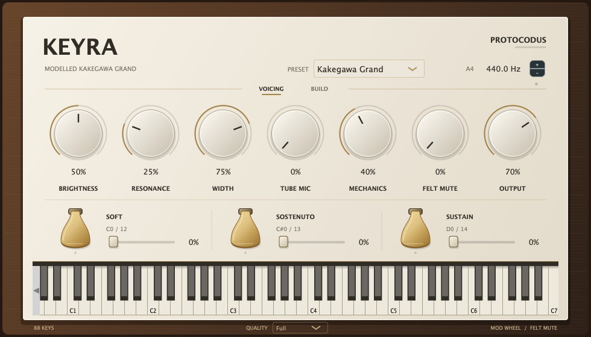

# Keyra

Keyra is a physically modelled piano that plays no samples: felt hammers
thrown at stiff strings, the strings of each unison coupled at the bridge, a
soundboard of plate modes radiating to four microphone pairs, and the open
strings and duplex scales ringing with them. Five pianos are designed, a
concert grand, a studio grand, a parlor grand, a baby grand and an upright,
and each is kept
as you like it: the hammers' felt, the strings' age, the unisons' tuning, the
tuner's stretch, the dynamic range, the lid, and how the soundboard, the
sympathetic strings and the duplex scales ring. Beside the model plays the
action measured from recordings for 1.x: the keys, the dampers and the
pedals' knocks. It builds as VST3 and CLAP plug-ins, an Audio Unit on macOS
and a standalone application. Version 2.0.0 replaces 1.x's partials fitted
from recordings with this model; what is not yet verified for it is listed
under Known gaps.



## Audio demos

One phrase per factory preset, written for what that preset is for and
rendered from `Docs/audio/midi/` through the shipping engine.

<!-- audio-demos-begin -->

| # | Preset | Demo | Length | Peak |
| --- | --- | --- | --- | --- |
| 1 | Concert Grand | [01-concert-grand.wav](Docs/audio/01-concert-grand.wav) | 11.2 s | -1.5 dBFS |
| 3 | Warm Walnut | [03-warm-walnut.wav](Docs/audio/03-warm-walnut.wav) | 11.1 s | -4.1 dBFS |
| 4 | Felt Nocturne | [04-felt-nocturne.wav](Docs/audio/04-felt-nocturne.wav) | 10.7 s | -10.3 dBFS |
| 5 | Open Strings | [05-open-strings.wav](Docs/audio/05-open-strings.wav) | 11.7 s | -4.0 dBFS |
| 6 | Upright | [06-upright.wav](Docs/audio/06-upright.wav) | 11.6 s | -3.0 dBFS |
| 8 | Pop Upright | [08-pop-upright.wav](Docs/audio/08-pop-upright.wav) | 11.6 s | -3.0 dBFS |
| 9 | Baby Grand | [09-baby-grand.wav](Docs/audio/09-baby-grand.wav) | 9.7 s | -7.3 dBFS |
| 10 | Distant Hall | [10-distant-hall.wav](Docs/audio/10-distant-hall.wav) | 10.8 s | -5.4 dBFS |

<!-- audio-demos-end -->

### Listening against the recordings

The physical model is fitted to no recording note by note, and against the
Salamander grand that 1.0.0 was fitted to it stands further off than 1.0.0 on
every score of `Tools/benchmark_recordings.py`
([report](Docs/validation/grand-recording-benchmark-2026-11-11.md), and Known
gaps). The owner judges it by ear against 1.0.0 in A/B sets, which are not
committed; `Docs/decisions.md` records the verdicts. The
[live renders](Docs/audio/live/manifest.json) are musical passages through
0.2.0's engine, frozen evidence from that version's review.

## Version history

### 2.13.1 — 2026-11-13 — the upright's bass tuned as an upright's is

The upright's keys below A3 sit higher again: A0 stands 8.9 cents under
equal temperament at Stretch 1 where 2.13.0 put it 28.7 under, A1 5.4
(14.8) and A2 2.8 (3.7). The four grands are 2.13.0's to the byte. The
panel and the saved state do not change. The upright's rows of the keys'
level table are written again and its output scale pinned to them (0.07
dB higher).

- **The upright's bass octaves are 4:2 all the way down.** 2.13.0 gave every piano the
  bass octaves read from the Salamander grand (6:3 by A2, 8:4 from A1).
  The Helsinki upright does not read so. On its own stiffness, about three
  times that grand's in the bass, 4:2 leaves its stretch from C1 to A2
  within 2.4 cents rms, 6:3 within 9.1 and 8:4 within 19.6; the grands'
  ladder stands 14.9 cents flat of it, 30 at C1
  (`Tools/measure_tuner_octaves.py --model upright`, which now also prints
  each recorded octave's partials beside one another: C1 to C2 stands 0.8
  cents narrow at 4:2, 5 at 6:3 and 18 at 8:4, where the grand's A0 to A1
  stands 4 wide at 8:4). Strings that stiff put the high partials a grand's
  tuner listens to too far apart to tune on.
- **The baby grand is not changed.** Its bass strings are as stiff as the
  model's upright's, and no small grand is among the recordings to say how
  one is tuned, so it keeps the grands' ladder (Known gaps).
- **Against the Helsinki recordings**
  ([against 2.13.0](Docs/validation/upright-bass-octaves-benchmark-2026-11-13.md),
  [2.12.0](Docs/validation/upright-bass-octaves-since-2-12-0-benchmark-2026-11-13.md)
  and [the shipping 2.11.0](Docs/validation/upright-bass-octaves-since-shipping-benchmark-2026-11-13.md)):
  beside 2.13.0 no single-note score is worse and nine are better, all at
  C1, D♯1, C2 and D♯2. The bass's tuning goes from 5.22 to 4.74 cents on
  the notes 1.0.0 fitted and 4.12 to 3.34 on the others, and its partials
  from 10.80 to 10.07 dB and 10.30 to 9.22; both stand under 2.12.0's
  too (4.77 and 4.02 cents, 10.62 and 9.98 dB). Beside 2.12.0 one score
  is worse: G♯3's tuning on the unfitted notes, 0.89 to 1.41 cents, the
  key under A3 that 2.12.0 tuned 6:3. Beside 2.11.0 it carries 2.12.0's
  changes to the image: 55 single-note scores worse and 60 better.

### 2.13.0 — 2026-11-13 — the bass tuned as a tuner tunes it, and half the cost in Reason

The bass sits lower, most on the small pianos, and the keyboard no longer
steps a cent at every A. The panel and the saved state are 2.11.0's; a
session opens as saved. Only the keys below A3 are retuned. The keys'
level table is written again and each piano's output scale pinned to it
(the baby grand's 0.1 dB lower).

- **Bass octaves on higher partials.** Through 2.12.0 every bass octave
  was tuned 6:3 and A3 itself 4:2, so G♯3 stood a cent off the line beside
  it, and the line stepped again at every A below. A tuner hears a bass octave on higher partials
  the lower it lies. The octave is now 4:2 at A3, 6:3 by A2 and 8:4 from
  A1 down, passing from one to the next key by key. Set against the
  Salamander grand: on that piano's own stiffness, 8:4 leaves its stretch
  from A0 to A2 within 1.4 cents rms and this ladder within 2.2, where 6:3
  throughout stood 3.6 cents sharp of it, 7.6 at A0
  (`Tools/measure_tuner_octaves.py`). At Stretch 1, A0 now stands 9.7
  cents under equal temperament on the concert grand (6.5 in 2.12.0), 19.6
  on the parlor grand (12.1), 29.9 on the baby grand (18.6), 28.7 on the
  upright (18.1) and 15.3 on the studio grand (9.5); A1 stands 4.7, 9.5,
  14.8, 14.8 and 7.7 under. A2 moves by under 0.3 cents. The Salamander's
  own A0 and A1 stand 16.5 and 5.1 under; the Studio Grand, whose bass
  strings are set against that piano, is the one to read beside it.
- **Four floats abreast, said in the source.** The strings' partials, the
  open strings, the board's modes and the dot products behind them are
  written four at a time (`Source/DSP/Four.h`). Each lane does what the
  one-float loop did, in its order: the same compiler gives the same bytes
  before and after, and so does the plain-loop fallback other compilers
  take. A plug-in's compiler already took most of these loops four at a
  time, so there a dense pedalled phrase costs about a tenth less (GCC 13:
  38 to 33 % of one core; Clang 18: 36 to 32 %). Reason's compiler takes a
  loop one float at a time unless the source says four: built the way it
  builds (no vectoriser, no builtins), the same phrase costs 73 % of a core
  before and 33 % after, a melody 14 % and 8 %. Those are 30 s renders on a
  development machine (an Intel Xeon at 2.1 GHz), not Reason's meter.
- **A new instance is ready sooner.** Designing the five pianos took half a
  second there, half of it asking the library for the same powers and
  exponentials again and again; they are taken once, the tables come out
  the same to the bit, and it takes a fifth of a second.
- **Nothing on the heap asks for more than a double's alignment.** The
  Rack's allocator promises 8 bytes, and code that trusts 16 or 32 faults
  on x86 there. The engine's members no longer ask.
- **Against the recordings**
  ([grand](Docs/validation/grand-tuner-ladder-benchmark-2026-11-13.md);
  [against the shipping 2.11.0](Docs/validation/grand-since-shipping-benchmark-2026-11-13.md)):
  the benchmark's tuning score moves the wrong way, 2.13 to 2.20 cents on
  the notes 1.0.0 fitted and 2.22 to 2.32 on the others, all of it in the
  bass (2.68 to 2.85 and 3.29 to 3.52); four single-note scores are worse:
  A0's tuning, 4.9 to 5.6 cents on both sets, A1's partials, 10.4 to 10.9
  dB, and F♯3's rise, 3.1 to 5.4 ms. That score is the mean over a note's
  first thirty partials, and the concert grand's bass strings are 26 to
  53 % less stiff than the Salamander's from A0 to C2 (Known gaps): with
  the fundamental nearer the recording's, the partials above it stand
  further under. Everything else moves by 0.03 or less. The
  [upright](Docs/validation/upright-tuner-ladder-benchmark-2026-11-13.md)
  against the Helsinki recordings: its tuning goes from 3.36 to 3.43
  cents on the fitted notes and 3.41 to 3.55 on the others, its bass's
  from 4.77 to 5.22 and 4.02 to 4.12, and its bass's partials 0.2 to 0.3
  dB further off; seven single-note scores are worse, all at C1, D♯1 and
  C2 (their tuning by 0.6 to 1.0 cents, C1's and C2's partials by 0.8 to
  0.9 dB, D♯1's rise, 10.6 to 19.4 ms, and decay). Nothing above the bass
  moves but the middle's tuning on the unfitted notes, 2.08 to 2.29
  cents.

### 2.12.0 — 2026-11-13 — the image a spaced pair hears

The close pair's image is wider and its bass holds together, as the recorded
grand's does; every pair's image changes. The panel and the saved state are
2.11.0's; a 2.11.0 session opens as saved. Every piano sounds different
through every pair, with each piano's level pinned again.

- **The phase between a pair's two microphones is the sound field's.** The
  model's board is one smeared plate whose modes are exact: every second
  one is odd across the board's middle and reaches two microphones either
  side of it exactly out of phase, in the bass too. 2.11.0 held those to
  70 to 90° and left the others as they fell, half of them in step. Each
  microphone now keeps the level it hears of a mode, and the angle between
  the two is what the sound field at a pair gives in the mean: for the
  board's own sound sin(kr)/(kr), r the most that the two paths from one
  point of the board can differ (van Cittert–Zernike); for the room's
  sin(kd)/(kd) across the spacing d (Cook and others 1955), times what the
  two patterns share; each weighed by how much of it the pair hears. A
  mode keeps the side its own phase fell on, and the turn is shared
  between the two microphones. Nothing in it is fitted to a recording.
- **Beside the recorded pair.** Over 150 of the Salamander's notes
  (`Tools/measure_pair_image.py`: 30 pitches at five layers) the
  recording's two channels are 0.79, −0.17, 0.05 and 0.08 alike in the
  octaves at 125, 250, 500 and 1000 Hz, each within 0.04. The close pair
  gives 0.78, 0.01, −0.05 and 0.08; 2.11.0 gave 0.57, 0.30, 0.27 and 0.17.
  Over everything above 20 Hz a note is 0.22 alike recorded, 0.15 now and
  0.40 in 2.11.0, so its mono sum holds 2.1, 2.4 and 1.5 dB less than its
  two channels.
- **Every pair in mono.** On three phrases the concert grand's close pair
  sums to mono 1.9 to 2.5 dB under its two channels (2.11.0 1.3 to 1.6),
  the XY pair 0.3 to 0.5 (0.6 to 0.9), the live pair 1.1 to 2.2 (1.1 to
  2.1) and the distant pair 2.5 to 3.2 (1.8 to 2.8), where two unrelated
  channels stand 3.0 under; the upright's close pair 2.4 to 3.0 (1.6 to
  1.8). No pair's phrase sums out of phase: the least alike, the distant
  pair's, reads −0.04.
- **Levels.** The keys' level table is written again and each piano's
  output scale pinned to it. Bar Piano's two pairs stand 1.6 dB higher
  (0.72 and 0.96): with the new image its typical playing read −11.4 VU
  where every preset is held near −9.
- **Against the recordings**
  ([grand](Docs/validation/grand-pair-image-benchmark-2026-11-13.md)): the
  benchmark's stereo balance stands 4.79 dB from the Salamander's on the
  notes 1.0.0 fitted (5.03) and 4.96 on the others (5.15). Its other
  stereo score reads how strongly two channels are related, not in which
  sense, and does not move (0.20 and 0.18; 0.20 and 0.19). Further off:
  the middle register's partials, 7.48 dB on the fitted notes (6.46) and
  7.05 on the others (6.52), and with them its attack, early and sustained
  spectra by 0.2 to 0.7 dB; the bass's level by 0.2 to 0.3 dB and the
  treble's stereo balance by 0.1 to 0.4 dB; the rise on the fitted notes,
  14.2 ms (13.3); 89 single-note scores, the largest C1's rise, 35.0 ms
  (12.0), then C3's, F♯4's and A3's. How much of that is the change and
  how much is chance is not told apart: 2.11.0 with nothing changed but the draw of its
  room's phases
  ([control](Docs/validation/grand-room-draw-control-2026-11-13.md)) moves
  the same scores as far: the middle's partials on the unfitted notes from
  6.52 to 7.36 dB, the stereo balance on the fitted notes from 5.03 to
  5.97, and 103 single-note scores worse. The law is drawn when the piano
  is designed and costs no CPU while it plays.
- **The upright against the Helsinki recordings**
  ([report](Docs/validation/upright-pair-image-benchmark-2026-11-13.md),
  run with 2.13.0's): its stereo balance stands 6.43 dB off on the fitted
  notes (6.62) and 6.03 on the others (6.21). Further off: its attack,
  7.65 dB (7.50) and 7.68 (7.33), its early spectrum on the unfitted
  notes, 9.08 (8.70), its noise, 9.80 (9.66) and 8.66 (8.49), the
  treble's partials on the fitted notes, 5.80 (5.35), and 58 single-note
  scores, the largest D3's rise, 79 ms (68), and the stereo balance of
  D7, C3 and D4, 7 to 12 dB (3 to 7). Those recordings are a coincident
  ribbon pair, so they score the upright's tone and level and not a
  spaced pair's image; as on the grand, a change of the phases alone
  moves single notes this far.
- **Tried and left out** (`Docs/decisions.md`): the whole turn given to
  one microphone; each mode put on whichever side was nearer, which took
  the bass apart (0.56 alike at 125 Hz); and the angle smoothed over a
  third of an octave instead of set mode by mode (0.38 alike at 250 Hz).

### 2.11.0 — 2026-11-12 — bass strings that beat each their own way

A held bass chord no longer sweeps like a phaser. The panel and the saved
state are 2.10.0's; a 2.10.0 session opens as saved. Every piano's wound
strings sound different, and the plain strings play as in 2.10.0, up to
0.25 dB louder with each piano's level pinned again.

- **Each wound string strays on its own.** A real string's partials stray
  from the ideal stiff string's series: the Salamander's bass partials
  stand 1.54 cents (median, A0 to B2) off the best stiff-string fit,
  2.10.0's 0.40. 2.10.0 drew that small stray once for a key, so the
  strings of a unison stood one ratio apart at every partial, each partial
  beat at a rate in proportion to its frequency, and together they swept
  like a flanger. Each wound string's partials now stray 1.5 cents (one
  standard deviation) their own way from the second up; the plain strings
  keep the shared stray. Measured as the recording is
  (`Tools/measure_partial_stray.py`, every third key from A0 to B2 at two
  layers): the stray 1.31 cents; on the partials within 20 dB of the
  strongest, how far each one's beat rate lies off its neighbours' 0.25
  (2.10.0 0.12, the Salamander 0.20), and how deep they swing 2.7 dB
  (1.4; the Salamander 2.0).
- **Against the recordings**
  ([grand](Docs/validation/grand-wound-stray-benchmark-2026-11-12.md),
  [upright](Docs/validation/upright-wound-stray-benchmark-2026-11-12.md)):
  the grand's bass decay stands 2.46 dB/s from the Salamander's on the
  notes 1.0.0 fitted (2.66) and 2.28 on the others (2.42), and its tuning
  on the fitted notes 2.12 cents (2.15). Further off: the bass's envelope,
  3.62 dB on the fitted notes (3.26) and 3.04 on the others (2.78), its
  beats now landing where the recording's do not; 12 single-note scores,
  at C1, A1 and C2, the largest C1's rise on the notes 1.0.0 never fitted,
  12.0 ms (4.1), and C2's envelope, 7.8 dB (5.5). The upright's decay
  stands 4.70 dB/s from the Helsinki's on the notes 1.0.0 never fitted
  (5.24) and its tuning 3.44 cents (3.67); 6 single-note scores are worse,
  at A1, A2 and C3, the largest A2's envelope and noise by 1.0 dB. The
  strays are drawn when the piano is designed and cost no CPU while it
  plays.
- **Tried and left out.** A smaller stray: at 1.0 and 0.75 cents the
  strong partials swing 2.4 and 2.3 dB, nearly as deep, so how deep they
  swing is not the stray's size (`Docs/decisions.md`).

### 2.10.0 — 2026-11-12 — a heavier bass, from the board beside its modes

The bass and the low middle are fuller, and how a note dies away comes from
the board and the bridge instead of a curve fitted to one recorded piano.
The panel and the saved state are 2.9.0's; a 2.9.0 session opens as saved,
and every piano sounds different.

- **What the board gives beside its modes.** The model's board is one
  smeared plate, whose few lowest modes take less from the strings than a
  ribbed board with its bridge does: between two of them a partial died as
  fast as its neighbours but reached the air a tenth as strong. That rest
  now radiates about the bridge through one filter per piano, from the
  board's lowest mode (50 Hz on the concert grand, 101 Hz on the baby
  grand) to where it falls past half (510 to 680 Hz), and only once the
  string's wave has reached the bridge. Against three reference grands (a
  commercial modelled piano's American, German and Japanese grands, the
  owner's renders) the concert grand's partials from 56 to 80 Hz stand
  2.7 dB under their median, where 2.9.0's stood 9.5 under, and from 112
  to 160 Hz 0.2 dB over (3.7 under); from 40 to 56 Hz they now stand
  5.2 dB over (0.6). The upright's bass rises by 5 to 10 dB and stays 7 to
  10 dB under those grands'.
- **The bridge between the strings and the board.** 2.9.0 held each key's
  pull on the board to a curve fitted to the Salamander's decay. That
  curve is gone: the strings meet the board through the bridge, a maple
  beam whose own impedance stands in their way, lighter from C5 to the top,
  and the board under it is evened as before to between 0.7 and 1.5 times
  an endless plate's. The strings' sideways motion, the aftersound, is set
  again for it.
- **Each piano's description** now holds its board (its mass and its two
  bending stiffnesses), its bridge (its mass and how it narrows) and where
  its hammers strike: what a piano from another maker would change. The
  five share one set today, typical values, since nothing measured tells
  one maker's board from another's.
- **The microphone pairs** were balanced on the board's modes alone, and the
  new sound beside them adds 0.2 dB to the concert grand's close pair and
  up to 1.3 dB to the others. The voicing now sets each pair's scale at the
  close pair's level without the room, averaged over the keys, and pulls a
  key down as far as up, 15 dB (the Studio Grand's G♯3 needed 14 in one
  mix).
- **Against the recordings**
  ([grand](Docs/validation/grand-board-beside-benchmark-2026-11-12.md),
  [upright](Docs/validation/upright-board-beside-benchmark-2026-11-12.md)):
  on the notes 1.0.0 never fitted, the grand's partials stand 7.4 dB from
  the Salamander's (7.7 in 2.9.0), its decay 3.3 dB/s (3.8), its first
  half second 6.0 dB (6.3), its envelope 3.9 (4.2) and its rise 11.9 ms
  (12.7); on the notes 1.0.0 fitted, its rise 13.2 ms (15.0). Further off:
  its level by register, 2.6 dB (2.1), because the top octave now plays
  about 3.2 dB louder beside the middle than the recording's (0.5 quieter
  in 2.9.0); the onset of A0 to C2, up to 60 ms later at some layers; its
  attack by 0.06 dB, and on the notes 1.0.0 fitted its tuning by
  0.08 cents. 108 single-note scores are worse. The upright's partials
  stand 7.6 dB from the Helsinki's (8.1), its sustain 10.0 dB (10.6) and its rise 9.1 ms (13.1); on the
  notes 1.0.0 fitted the bass's rise is 10.7 ms (22.4). Further off: its
  stereo balance, 6.2 dB (5.7), and on the notes 1.0.0 fitted its tuning,
  3.4 cents (3.3), and attack, 7.5 dB (7.3); 72 single-note scores are
  worse. The CPU is 2.9.0's within the development machine's noise.
- **Tried and left out.** A board of 1.0e3 kg/s, under half a measured
  board's impedance: whole notes from A1 to A3 died
  too fast (C3 at 12.3 dB/s, the Salamander's 7.1). Weighing each partial
  by what the board leaves out of it: a bass note then sounded before its
  string's wave had reached the bridge. A radiation rising to the treble,
  the ribs' stiffness above their spacing, and tuning a key by its first
  six partials: each put the recordings' notes further off on four layers
  (`Docs/decisions.md`).

### 2.9.0 — 2026-11-12 — a Studio Grand, and the pedal's whisper

A fifth piano, and the strings answer the pedal itself. The saved state is
2.8.0's with one more choice of Piano; a 2.8.0 session opens as saved, and
the four older pianos' notes are 2.8.0's sample for sample until the pedal
goes down.

- **Studio Grand**, 2.0 m: the size of the grand the benchmark's recordings
  are of. Its bass strings' length (1.60 m at A0) and the key where plain
  steel begins (B2) are set against those recordings' inharmonicity below
  C4, which the model's then stands within a factor of 0.75 to 1.54 of,
  note by note; the rest is typical of the size. It is the last choice of
  Piano, and the Studio Grand preset, which played the parlor grand, plays
  it. Against the recordings it is no nearer than the Concert Grand
  overall: on the notes 1.0.0 never fitted its partials stand as far
  (7.7 dB), its tuning, decay and envelope a little nearer (2.0 cents,
  3.7 dB/s, 3.9 dB against 2.2, 3.8 and 4.2), and its attack, sustain,
  stereo balance and rise further (the rise 20 ms against 13), with 221
  single-note scores worse
  ([benchmark](Docs/validation/studio-grand-benchmark-2026-11-12.md)).
- **The pedal's whisper.** A damper's felt lets its strings go as it
  lifts, and they ring: the sustain pedal alone now sets the open strings
  whispering, less for a pedal let down slowly, scaled by Sympathetic and
  silent at 0. It is set beside the engine's pedal knock as the
  Salamander's two pedal-down takes hold it from 300 Hz to 1 kHz; the
  takes' low ring, 25 to 35 dB stronger under 150 Hz, is not there. It
  costs nothing while notes sound; pressed on a silent piano the pedal
  wakes the model until the whisper has died.
- **Tried and left out.** A brighter radiation above 6 kHz, for the top
  end loud notes lack: on four layers the partials moved by 0.13 dB at
  most either way, the bass's noise on the fitted notes 1.0 dB further off
  and the middle's on the others 0.5 dB nearer.

### 2.8.0 — 2026-11-12 — how a grand's upper notes die away

On the three grands a note from middle C up falls away as the recorded
grand's does, where it held on too loud after its first second. The panel
and the saved state are 2.7.0's; a 2.7.0 session opens as saved and the
grands' notes from C4 up ring differently. The upright is 2.7.0's, sample
for sample.

- **The unisons** of a grand stand closer together up the keyboard: the
  spread Detune sets is whole up to B3 and narrows to half from C5 up. A
  tuner sets a unison by its beats, which the same cents make faster the
  higher the note. With the whole spread everywhere the first partial of
  the Salamander grand's notes from C5 up stood 7 to 8 dB over the
  recorded one 1 to 1.5 s after the blow; it stands 1.0 to 1.4 dB over.
  The upright keeps the whole spread: narrowed, its decay stood further
  from the Helsinki upright's.
- **Against the recordings**
  ([grand](Docs/validation/grand-unison-spread-benchmark-2026-11-12.md)):
  on the notes 1.0.0 never fitted, the grand's decay stands 3.8 dB/s from
  the Salamander's (4.2 in 2.7.0), its sustain 7.9 dB (8.2), its envelope
  4.2 (4.4) and its partials 7.7 (7.9); its tuning is 2.2 cents off (2.1).
  The other scores moved by less than 0.05. 23 single-note scores are
  worse, listed in the report.

### 2.7.0 — 2026-11-12 — a denser room, and a bridge with length

The room no longer rings like a spring after a short note, and a key's
colour stands closer to its neighbours'. The panel and the saved state are
2.6.0's; a 2.6.0 session opens as saved and every key sounds a little
different.

- **The room** is sixteen delay lines mixed by a Hadamard matrix where it
  was eight under a Householder reflection, and the case's knock passes
  three allpass sections before it enters. Its echoes grow dense in 130 to
  180 ms where they took 310, and its level is kept. Under a treble note
  the knock's tail from 280 to 710 Hz stands 19, 24 and 37 dB under its
  peak 100, 150 and 300 ms on, where the recording's stands 21, 24 and 36
  and 2.6.0's stood 21, 29 and 39.
- **The bridge** hands a plain string's force to the soundboard along its
  own length, half its bending wavelength at each board mode, where every
  string drove the board at a point. Every key is voiced again for it, and
  a key may now be pulled 15 dB onto the even scale (12 before).
- **The sustain pedal** stops a little higher (0.695 of its travel, was
  0.7): with the new bridge a chord let go under it rang longer than the
  owner chose, and this brings it back (60 dB in 11.1 s on the concert
  grand and 9.2 s on the upright, where 2.6.0 took 10.7 and 10.2).
- **Against the recordings**
  ([grand](Docs/validation/grand-room-bridge-benchmark-2026-11-12.md),
  [upright](Docs/validation/upright-room-bridge-benchmark-2026-11-12.md)):
  on the notes 1.0.0 never fitted, the grand's level difference between
  the channels stands 5.3 dB from the Salamander's (5.7 in 2.6.0), its
  level 2.1 (2.5), its first half second 6.3 (6.5), its noise 6.7 (7.0),
  its attack 6.3 (6.4) and its partials 7.9 (7.9): 7.0 (7.1) in the middle
  and 7.2 (7.5) from C6 up, but 9.9 (9.5) in the bass. Its rise is 12.7 ms
  off (12.2). The upright's partials stand 8.1 dB off (8.6) and its noise
  8.9 (9.2); its tuning 3.6 cents (3.1), its level difference between the
  channels 5.7 dB (5.1) and its sustain 10.6 (10.4) are further off. 71
  single-note scores of the grand and 29 of the upright are worse, listed
  in the reports.

### 2.6.0 — 2026-11-11 — what rings under a treble note

From A5 up something rings on under a note after the blow, as it does on the
recorded grand. The panel and the saved state are 2.5.0's; a 2.5.0 session
opens as saved and its top two and a half octaves sound different.

- **The case in the room**: the knock the blow gives the frame and the case
  (2.4.0) reached the microphones only through the board, and died away
  under a treble note twice as fast as on the Salamander grand. The room
  now hears it as well: from 280 to 710 Hz it stands 21 and 39 dB under its
  peak 100 and 300 ms on, where the recording's stands 21 and 36 and
  2.5.0's stood 28 and 47. Keys below A5 are as they were.
- **Against the recordings**
  ([grand](Docs/validation/grand-case-ring-benchmark-2026-11-11.md),
  [upright](Docs/validation/upright-case-ring-benchmark-2026-11-11.md)):
  on the notes 1.0.0 never fitted, the grand's first half second stands
  6.5 dB from the Salamander's in third octaves (7.0 in 2.5.0), its attack
  6.4 (6.6) and the noise between its partials 7.0 (7.5); from C6 up 7.9
  (9.6), 7.2 (7.8) and 7.5 (9.1). The upright's stand 9.0 (9.3), 7.4 (7.6)
  and 9.2 (9.5). The other scores moved by 0.1 or less. Two single-note
  scores of the grand and one of the upright are worse, listed in the
  reports.
- **The benchmark's noise score** counted a render's partial that stood off
  the recording's twice, as a missing partial and as noise; it is now left
  out of the noise. 2.5.0's noise reads 7.5 dB by it (7.6 before) and the
  upright's 9.5 (9.7).

### 2.5.0 — 2026-11-11 — the string scale

The strings are as stiff as the recorded pianos' are, so a note's upper
partials sit where a real piano's do. The panel and the saved state are
2.4.0's; a 2.4.0 session opens as saved and sounds different.

- **Strings of the measured stiffness**: the plain strings were 10 to 100 %
  stiffer than the Salamander grand's and the Helsinki upright's, which put
  middle C's twentieth partial 18 cents sharp of the recorded note's and
  C3's thirtieth 37 cents. The plain strings now keep their length down to
  the break and the wound strings have their own run to A0; the concert
  grand's inharmonicity stands within 8 % of the Salamander's from C3 to
  F♯6. The tuner's stretch follows the new partials.
- **Against the recordings**
  ([grand](Docs/validation/grand-string-scale-benchmark-2026-11-11.md),
  [upright](Docs/validation/upright-string-scale-benchmark-2026-11-11.md)):
  on the notes 1.0.0 never fitted, the grand's partials stand 7.9 dB from
  the Salamander's (8.2 in 2.4.0, their first move since 2.0.0) and its
  tuning 2.1 cents (3.2); the upright's 8.4 dB (9.6) and 3.2 cents (4.3).
  The other scores moved by 0.2 or less. 13 single-note scores of the grand
  and 11 of the upright are worse, all listed in the reports.
- Keys re-voiced and each piano's typical playing re-pinned to −9 VU.

### 2.4.0 — 2026-11-11 — the key presses

No two presses of a key sound alike, the thump under a note is the action
catching the hammer, and the top octave is set against the recordings. The
panel and the saved state are 2.3.0's; a 2.3.0 session opens as saved and
sounds different.

- **Key noises that vary**: a key landing or coming back, a damper and the
  pedal were the same sound every time. Each knock now draws its own level,
  each of its body modes a level and a phase, and its click a rise and a
  level in each band: two returns of one key differ by 1.4 to 1.9 dB and
  are 0.60 to 0.75 alike, where the Salamander grand's neighbouring keys
  differ by 1.5 dB and are 0.56 alike.
- **Two knocks under a note**, where one thump came with the blow. Recorded
  notes hold a thump under 180 Hz that comes 14.5 to 22 ms after the onset,
  later the softer the note: the action catching the hammer on its way
  back. The model's arrives within 4 ms of the Salamander's at seven
  velocity layers and stands within 4 dB of it in the median from C4 to C8
  (single keys up to 14 dB off), and no two catches are alike. Above 180 Hz
  a knock comes with the blow, from A5 up only, where the strings end on the
  frame's capo d'astro bar: 2 to 4 dB over the recording's from A6 to C8.
  Nothing precedes a bass note any more.
- **The top octave**: the hammers above C5 are harder (by three quarters of
  a decade at C8), the bridge holds the top strings in full, and they lose
  more on their own. The fundamentals of C7, F♯7 and C8 fall 28 to 35 dB in
  their first 300 ms, where the Salamander's fall 21 to 36 and 2.3.0's fell
  8 to 15; a soft note's stands 9 to 17 dB under a mezzo-forte one's, where
  the Salamander's stands 8 and 2.3.0's stood 12 to 20.
- **The room in the close pair**: what a treble note leaves from 280 to
  710 Hz, 300 ms after the knock under it, stood 67 dB down; it stands 47,
  the Salamander's 36. Room still sets how much.
- **The upright's thump** is set against a recorded upright (MAPS,
  ENSTDkCl): within 3.1 dB of it in three bands at three velocities.
- **Level**: each piano's typical playing stays at −9 VU.
- **Against the recordings**: on the Salamander grand's notes 1.0.0 never
  fitted, the attack is closer (7.8 to 6.6 dB), the first half second (8.1
  to 7.0), the noise between the partials (9.3 to 7.8), the sustain (8.7 to
  8.4) and the rise (15 to 13 ms); from C6 up the first half second moves
  from 12.7 to 9.6 dB and the partials from 9.0 to 7.5. Further off: the
  tuning (2.8 to 3.2 cents), the decay (3.7 to 4.1 dB/s; from C6 up 5.3 to
  7.0), the envelope (4.2 to 4.6 dB) and the bass's partials (8.6 to
  9.7 dB), the price of the room in the close pair. 106 single-note scores
  are worse, where 2.3.0 had six: the furthest F♯3's rise (41 to 51 ms),
  C8's decay (7.8 to 15.4 dB/s) and sustain (18.8 to 22.4 dB) and A3's
  noise (7.4 to 10.6 dB)
  ([report](Docs/validation/grand-key-presses-benchmark-2026-11-11.md)). On
  the Helsinki upright's the attack (8.5 to 7.5 dB), the first half second
  (10.2 to 9.1) and the noise (11.2 to 9.8) are closer and the partials
  further off (8.6 to 9.6 dB); 39 single-note scores are worse, the furthest
  D♯1's rise (38 to 50 ms) and E7's decay (3.6 to 11.6 dB/s)
  ([report](Docs/validation/upright-key-presses-benchmark-2026-11-11.md)).

### 2.3.0 — 2026-11-11 — the open strings

The strings whose dampers are off answer a blow as recorded pianos' do. The
panel and the saved state are 2.2.0's; a 2.2.0 session opens as saved and
sounds different.

- **Under the pedal**: a blow now moves the iron frame the strings end on,
  and that sets every open string ringing. Between a note's partials the
  parlor grand held 25 dB less than the Yamaha C3's pedal-down takes; it
  holds 6 to 8 dB less.
- **The top strings**, which have no dampers, ring under every note: 40 dB
  too quietly before, within 3 dB of the Salamander grand's under a forte
  note from C5 to F♯7. They ring longer too (about 28 dB/s where they died
  at 35 to 80; the recording's take 8 to 35), since a unison out of tune
  loads the bridge once, not once a string.
- **Level**: each piano's typical playing stays at −9 VU.
- **Against the recordings**: on the Salamander grand's notes 1.0.0 never
  fitted, the first half second is closer (8.9 to 8.1 dB, from C6 up 15.4 to
  12.7), the noise between the partials (9.9 to 9.3), the sustain (9.1 to
  8.7) and the attack (8.1 to 7.8); the partials are 0.04 dB further off.
  Six single-note scores are worse, five of them the channels' likeness at
  C8, F♯7 and D♯7
  ([report](Docs/validation/grand-open-strings-benchmark-2026-11-11.md)). On
  the Helsinki upright the attack, the first half second and the noise are
  closer by 0.1 to 0.3 dB; on the notes 1.0.0 never fitted the partials (8.5
  to 8.6 dB) and the decay (5.6 to 5.7 dB/s) are further off, and two
  single-note scores are worse
  ([report](Docs/validation/upright-open-strings-benchmark-2026-11-11.md)).

### 2.2.0 — 2026-11-11 — an even scale

The keys are voiced. The panel and the saved state are 2.1.0's; a 2.1.0
session opens as saved and sounds different.

- **Even keys**: a board answers each frequency in its own way, so 2.1.0's
  keys came out of the microphones 2.2 to 2.8 dB apart from one to the next
  on average, single keys 7 to 11 dB off the line through the keyboard. Each
  key's strings now pull on the board by what puts the key on that line in
  the microphone mix that is set: neighbours stand 0.3 to 0.4 dB apart at
  the default Lid and Soundboard, in single pairs and in mixes, and 0.9 to
  1.6 dB at other Lid and Soundboard settings (2.0 to 2.8 dB before).
- **Level**: each piano's typical playing is pinned to −9 VU again.
- **Against the recordings**: the loudness error across the Salamander
  grand's notes falls from 3.4 to 2.5 dB on the notes 1.0.0 never fitted
  (3.7 to 2.7 dB on the fitted ones) and the noise between the partials from
  10.1 to 9.9 dB; no other score moves by more than 0.2. 21 single-note
  scores are worse, the furthest F♯4's rise (16 to 22 ms) and noise (5.7 to
  7.4 dB) and the levels of D♯7 and A5 (by 1.6 to 1.7 dB)
  ([report](Docs/validation/grand-even-scale-benchmark-2026-11-11.md)). On
  the Helsinki upright the level error falls from 5.0 to 4.3 dB on the
  fitted notes; on the 21 notes 1.0.0 never fitted the noise is further off
  (11.0 to 11.4 dB) and the rise (12.6 to 13.0 ms), and 15 single-note
  scores are worse, the furthest F♯4's rise (1.7 to 8.5 ms)
  ([report](Docs/validation/upright-even-scale-benchmark-2026-11-11.md)).

### 2.1.0 — 2026-11-11 — velocity, the stereo image and a closer fit

The physical model fitted closer to the recordings. The panel and the saved
state are 2.0.0's; a 2.0.0 session opens as saved and sounds different.

- **Velocity**: the hammer's speed now follows the velocity, so that at
  Dynamics 0.5 the notes' levels stand within 2 dB of the Salamander grand's
  sixteen layers from velocity 31 up and 2.6 dB under them below it.
  2.0.0's speeds were even in dB, which left its soft and medium notes
  2.5 dB too quiet and its hardest 4.5 dB too loud against those layers.
  Dynamics spans 10 dB at 0, 25 dB at 0.5 and 40 dB at 1.
- **Felt**: the felt stiffens more steeply under a harder blow, fitted to
  the same layers, so soft notes are darker and hard ones brighter. Hammer
  and the practice felt cover half as many decades again, which keeps what
  each did to the tone.
- **Stereo image**: wider. A microphone pair's channels may now be up to a
  quarter turn out of step at each mode of the board, where 2.0.0 held them
  within 70°: on the first demo's phrase the channels' correlation is 0.33
  where it was 0.49, and each pair still sums to mono (Close 0.33, XY 0.67,
  Live 0.31, Distant 0.06).
- **Top end**: the board radiates fully up to 6 kHz, where 2.0.0's began to
  fall at 3 kHz. On the first demo's phrase the concert grand holds 3.6 dB
  more in the 2 kHz octave, 3.7 dB at 4 kHz and 7.1 dB at 8 kHz.
- **Treble sustain**: the bridge takes less from the strings between D♯3 and
  D6, so the upper keys ring longer.
- **Level**: each piano's typical playing is pinned to −9 VU again.
- **Against the recordings**: closer to the Salamander grand than 2.0.0 on
  ten of the benchmark's twelve scores, on the notes 1.0.0 never fitted
  (partial levels 11.7 to 8.2 dB, decay 5.5 to 3.7 dB/s, sustain 10.9 to
  9.1 dB). Its two stereo scores did not improve (the channels' level
  difference 5.4 to 5.6 dB, their correlation 0.21 as before), and 97
  single-note scores are worse, C3's rise the furthest (19 to 57 ms)
  ([report](Docs/validation/grand-velocity-stereo-benchmark-2026-11-11.md)).
  The upright is benchmarked against the Helsinki recordings for the first
  time, and there the change is mixed: on the notes 1.0.0 never fitted the
  partials (8.8 to 8.4 dB), the tuning (6.1 to 4.7 cents) and the envelope
  are closer, and the attack (7.7 to 8.5 dB), the first half second, the
  sustain (9.9 to 10.8 dB), the decay, the noise between the partials and
  the rise are further off
  ([report](Docs/validation/upright-velocity-stereo-benchmark-2026-11-11.md)).

### 2.0.0 — 2026-11-11 — a physical piano

The strings, hammers, soundboard and microphones are a new engine, written
from nothing: a physical model in place of 1.x's partials fitted from
recordings of five pianos. The action's noises, the pedals, the keyswitches
and the output stage are 1.0.0's.

- **Four pianos**: Concert Grand (2.74 m), Parlor Grand (1.86 m), Baby Grand
  (1.50 m) and Upright (1.25 m), each a string scale, hammers, soundboard and
  case of its size. The five measured pianos and their part-by-part builds
  are gone.
- **The piano's controls**: Hammer (soft to hard felt), String age, Detune
  (the unisons), Stretch (the tuner's), Dynamics (the span from the softest
  to the hardest blow), Lid, Soundboard, Sympathetic, Duplex and a Practice
  felt. Brightness, Resonance, Stiffness, Unisons, Ring, Quality and Tube Mic
  are gone.
- **Four microphone pairs**, each with its own level: Close (over the
  hammers), XY (at the lid), Live (in the room) and Distant (across it), and
  a Room control for the pairs that hear the room.
- **Twelve factory presets** for the new pianos in the old ones' program
  slots, six under the names they had; four demo phrases are renamed for
  them.
- **A full sustain pedal** rings about as long as the one chosen by ear on
  2026-10-30: a chord let go under it falls 60 dB in 9.6 s on the concert
  grand and 10.4 s on the upright.
- **Sessions**: a 1.x session opens with its Output, Width, Tuning, Felt
  mute, Mechanics and pedals as saved, its Brightness as Hammer and its
  Resonance as Sympathetic, on the Concert Grand (the Upright where its
  strings were mostly the Helsinki upright's) with the other new controls at
  their defaults. It does not sound as it did. The plug-in's identifiers are
  unchanged.
- **CPU**: the eight demos take 6 to 13 % of one core on a development
  machine; there is no Quality setting.
- **Against the recordings**: further from the Salamander grand than 1.0.0 on
  every score, since 1.0.0 was fitted to it and 2.0.0 is fitted to no one
  recording ([report](Docs/validation/grand-recording-benchmark-2026-11-11.md)).
  The upright is not yet benchmarked against its recordings.

### 1.0.0 — 2026-11-10 — the first release, and the last of the modal engine

0.4.38's engine, unchanged: partials fitted from recordings of five pianos.
Its forty versions from 0.2.0 are in the
[release history of 1.x](Docs/release/release-history-1.x.md), and
[how that engine worked](Docs/research/modal-engine-1.0.0.md) is kept beside
it.

## Downloads

<!-- build-download-begin -->
**[Download main build 131](https://github.com/protocodus/virtual-instrument-keyra/actions/runs/43487330075/artifacts/14069392357)**, built from [`7c0724ca5b35`](https://github.com/protocodus/virtual-instrument-keyra/commit/7c0724ca5b358492a74616569c310f0dae9d9d93). It holds the macOS, Windows and Linux packages, `SHA256SUMS` and `BUILD.txt`.
<!-- build-download-end -->

---

## How it works

### The piano model

`Source/DSP/PianoModel.cpp` is the piano. Nothing in it is a recording or a
table fitted note by note: a piano is a description (its `Design`, a string
scale and the constants beside it) and the controls. The papers each part
follows are cited beside the code.

**Strings.** Each string is the modes of a stiff, lossy string hinged at both
ends, partial k at k f0 √(1 + B k²) (Fletcher 1964), up to 160 partials in
the bass and three at C8. The scale is built from each piano's size: speaking
lengths that double a little less than every octave down from C8's 51.5 mm,
no plain string longer than 0.87 of A0's, the wound strings running from
there to A0's length on a bridge of their own (set against the
inharmonicity the Salamander grand's and the Helsinki upright's partials
give), plain steel wire from 0.775 mm at the top to
1.125 mm at the break, copper-wound strings below it, one string a key at
the bottom, then two, then three. Tension, mass and inharmonicity follow from
those (B is 0.00028 at the concert grand's middle C and 0.00031 at the baby
grand's). Every partial loses by the string's own damping, which rises with
frequency, and by what the bridge takes from it.

**Hammers.** A hammer is a mass on felt that stiffens as it is compressed and
gives way while it is held: Stulov's hysteretic felt with his measured
hammers, given at C2, C4 and C7 as Chaigne and Askenfelt's three hammers are
and carried across the keys. The blow is solved against the string's own
motion at the strike point, twice a sample at 44.1 and 48 kHz, for as long
as they touch, so a hard blow is brighter because the felt is stiffer under
it and a restrike meets a string already moving. The hammers' stiffness and
the strings' losses are fitted to notes of one recorded grand (Jon Meyer's
"Steinway Grand" for Decent Sampler, from the owner's reference set); the
upright's stiffness to eleven forte notes of a recorded upright (MAPS,
ENSTDkCl). How steeply the felt stiffens is fitted to the Salamander grand's
sixteen velocity layers, with the force kept where the felt is 1 mm in.

**Velocity.** Full velocity is a blow of 5 m/s, and under it the hammer's
speed is the velocity to a power that Dynamics sets: 1 at 0.5, where the
notes' levels stand within 2 dB of the Salamander's layers from velocity 31
up (2.6 dB under them below it) and within 2 dB of a Disklavier's notes
(MAPS, ENSTDkCl). The softest key still strikes, at 0.28 m/s.

**Unisons.** The strings of a key, each in two polarisations, share the
bridge, whose admittance couples them (Weinreich 1977): that gives the
prompt sound, the slower aftersound and their beating. The first 48 partials
of each string are kept apart, the first 16 also across the bridge; above
them the strings move together. From C5 down the strings' stretching as
they swing pulls the bridge at twice each partial's frequency (Conklin
1999), the phantom partials of a bass note.

**Soundboard.** The bridge drives the modes of a ribbed plate smeared into
one orthotropic plate, up to 224 of them under 2.6 kHz, with a point
impedance of about 2500 kg/s and a modal density of about 0.05 per Hz, as
measured boards have (Ege, Boutillon and Rebillat 2013; Giordano 1998). The
bridge's admittance at each key comes from those modes, evened to between
0.7 and 1.5 times an endless plate's as a ribbed board's is, so a string's
decay depends on where it crosses the bridge. The strings meet the board
through the bridge itself, a maple beam 33 mm high whose own impedance
stands in their way, lighter toward the treble (an assumed narrowing to
25 mm, 0.47 of its impedance at C8). What the smeared plate's few lowest
modes leave out of that, between them a partial dying as fast but reaching
the air a tenth as strong, radiates about the bridge as the bridge's own
sound does above the modes: through one filter per piano, from the board's
lowest mode to a few hundred hertz, after the string's wave has arrived.
The long bridge is a beam: a plain string's force reaches each mode as the mean of the mode's shape along half
the bridge's bending wavelength at that frequency; the wound strings' short
bridge drives the board at a point. Above the modes the board moves and
radiates near the bridge only.

**The knocks under a note.** Recorded notes hold two knocks under their
fundamental, and so does the model. The thump, under about 350 Hz, is the
action catching the hammer as it comes back off the string: 14 ms and the
time the hammer takes over 11 mm at the speed it rebounds with, so later
after a soft blow, and at once on the upright. Its momentum goes through the
key into the keybed, and the case hands it to the board's edge, three
quarters of it along the whole edge and the rest at the key's own place. The
knock, above 180 Hz, comes with the blow and only from A5 up, where the
strings end on the frame's capo d'astro bar instead of on agraffes: the
blow's lean on that bar reaches the board's edge at the key's place. Both
are fitted to the Salamander grand's notes, the upright's thump to a
recorded upright's (MAPS, ENSTDkCl); no catch is like the last, by 2 dB and
a fifth of its time.

**Voicing.** A board answers each frequency in its own way, so a key comes
out of the microphones stronger or weaker than its neighbours, as a piano's
keys do before a technician voices them: unvoiced, the model's neighbours
stand 3.7 to 4.5 dB apart and single keys up to 12 dB off.
`KeyraLevels --write-keys` measures what each key's strings alone give each
microphone pair, and every two pairs together, since pairs in a mix add as
waves, against a smooth line through the keys, and writes
`Source/DSP/KeyVoicing.h`. Each key's strings pull on the board by what
brings the key onto that line in the mix that is set, by no more than 15 dB
either way. Each pair's line is set at the close pair's level without the
room, averaged over the keys, which keeps the pairs balanced where the
board's modes alone do not. The table is measured at the default Lid and
Soundboard and at half velocity; the knocks under a note are not voiced.

**Sympathetic strings and duplex scales.** Every string whose damper is
lifted, by its key, the sostenuto or the pedal, answers what is played, ten
partials and two duplex-scale modes a key. Two things drive it: the
bridge's motion, and the iron frame, which gives under a blow's lean and
moves the string's near end (1.2e-7 m/N below 500 Hz, less above, fitted to
the Yamaha C3's pedal-down takes and the Salamander grand's top strings). A
unison rings as one mode: in tune its strings load the bridge once each,
and further apart than the bridge couples them, once in all (Weinreich
1977). The top keys have no dampers (from F♯6 on the concert grand) and
always answer. The upright has no duplex scales.

### Five pianos

| Piano | A0's speaking length | Soundboard | First plain-steel key | First key without a damper |
| --- | --- | --- | --- | --- |
| Concert Grand, 2.74 m | 2.01 m | 1.45 × 1.55 m | F2 | F♯6 |
| Parlor Grand, 1.86 m | 1.40 m | 1.42 × 1.12 m | B2 | F♯6 |
| Baby Grand, 1.50 m | 1.14 m | 1.40 × 0.86 m | C♯3 | F6 |
| Upright, 1.25 m | 1.18 m | 1.40 × 0.95 m | D♯3 | D♯6 |
| Studio Grand, 2.0 m | 1.60 m | 1.43 × 1.22 m | B2 | F♯6 |

The dimensions are typical of each kind of piano, not one maker's
instrument. Each piano's description also holds its board's mass and
bending stiffnesses, its bridge's mass and narrowing, and where its hammers
strike; the five share one board, bridge and strike point (a board of
about 2500 kg/s, a maple bridge, the hammers at 0.12 of the string up to
C5), since no measurement says how one maker's differ from another's. The
smaller pianos have shorter, stiffer bass strings (more inharmonic, so tuned with more stretch), lighter and harder hammers and a
smaller board. Changing the piano stops what sounds.

### Microphones and the room

Each mode's radiation to each microphone is Rayleigh's integral over the
plate, with the floor's reflection and, on a grand, the lid's at three
positions (closed, the short stick at 14°, open at 38°). Four pairs hear the
piano, each with its own level:

- **Close**: a spaced pair inside, 20 cm over the strings by the hammers
  (behind an upright's board). The pop sound.
- **XY**: a coincident cardioid pair at the open lid, about a metre off
  (behind an upright).
- **Live**: a spaced pair in the room, 2.3 m from a grand's side; over the
  player's head at an upright.
- **Distant**: a wide pair across the room, 4 to 6 m off.

At the same level every pair plays the piano as loud as the close pair: a
level is a balance, and the distance is in the sound already. The room is a
feedback delay network of sixteen lines under a Hadamard mix (Jot and
Chaigne 1991) ringing 0.8 s,
which hears the piano as the distant pair does and which each pair hears by
its distance, the close pair too (set against what the Salamander grand's
treble notes leave after the knock under them); Room sets how much. The
room also hears the case: the knock the blow gives the frame under the top
strings goes to it directly, through three allpass sections (Schroeder
1962), as well as through the board. Width at 0.75 is the pairs' own image and
0 is mono.

Each microphone hears a mode at the level Rayleigh's integral gives it, and
the two of a pair hear it in the phase the sound field at a pair gives in
the mean. The smeared plate's own phases would not do: its modes are exact,
every second one odd across the board's middle and so exactly out of phase
at two microphones either side of it, in the bass too, as no ribbed and
bridged board's are. The cosine of the angle between the two microphones
is, for the board's own sound, sin(kr)/(kr), with k the wavenumber in air
and r the most that the two paths from one point of the board can differ
(the van Cittert–Zernike theorem: a pair close over a wide board hears it
from every side, a pair far off from one direction); for the room's share,
sin(kd)/(kd) across the pair's spacing d (Cook and others 1955) times what
the two patterns share of a diffuse field, (3 + the cosine of the angle
between them) / 4 for cardioids; and between the two by how much of each
the pair hears of that mode. The mode keeps the side its own phase fell
on, and what there is to turn is shared between the two microphones. So
the close pair is alike in the bass and unrelated from about 250 Hz up,
the coincident pair stays alike throughout, and the distant pair is the
room's. Nothing in it is fitted: over 150 notes the close pair's two
channels stand within 0.1 of the Salamander grand's in every octave from
125 Hz to 2 kHz but the one at 250 Hz (2.12.0 above, and Known gaps). The
recordings at hand show no steady lean of low keys to one side and high
keys to the other, so the model adds none: where a key sits in the image
is what the board and the microphones give it.

### Controls

| Control | Range | What it changes |
| --- | --- | --- |
| Piano | five | The piano that plays (above) |
| Hammer | −1 to 1 | The felt's stiffness, a decade and a half from soft and worn-in to hard: ×10^(0.75 Hammer) |
| String age | 0 to 1 | Old strings lose their upper partials' sustain, wound ones most, and beat against themselves |
| Detune | 0 to 1 | How far apart a unison's strings are tuned: pure at 0, 6 cents of spread at 1, a bar piano (on a grand, half that from C5 up). 0.3 by default |
| Stretch | 0 to 2 | The tuner's stretch. At 1, octaves are tuned on the strings' own partials (4:2 from A3 up; down a grand's bass 6:3 by A2 and 8:4 from A1, the upright's 4:2 throughout; Railsback's curve); 0 is equal temperament |
| Dynamics | 0 to 1 | The span of hammer speeds from the softest to the hardest blow under 5 m/s at full velocity: 10 dB at 0, 25 dB at 0.5, where the speed follows the velocity, and 40 dB at 1 |
| Lid | 0 to 1 | Closed, the short stick at 0.5, open; an upright's top |
| Soundboard | 0 to 1 | How long the board rings: its loss halves from 0.5 to 1 and doubles to 0 |
| Sympathetic, Duplex | 0 to 1 | How strongly the open strings and the duplex scales answer |
| Close, XY, Live, Distant | 0 to 1 | Each microphone pair's level |
| Room | 0 to 1 | The room in the pairs that hear it |
| Width | 0 to 1 | The stereo image |
| Practice felt | 0 to 1 | A felt strip between hammers and strings: up to three decades softer |
| Felt mute | 0 to 1 | Felt laid on every sounding string, held or not (the mod wheel) |
| A4 tuning | 415 to 466 Hz | Concert pitch |
| Mechanics | 0 to 2 | How loud the action plays |
| Output | 0 to 1 | The output level |

The hammer, the practice felt, the dynamics and the strings' age are taken
by the next strike; everything else applies to what sounds.

### The action

The keys landing and coming back, the dampers falling and the sustain
pedal's knocks are 1.0.0's, unchanged: knocks on measured body modes and
bursts of band noise, fitted as numbers from the Salamander grand's
recordings under the three grands and from the Helsinki upright's under the
upright, in the room those were recorded in. No recorded waveform plays.
They follow the velocity of the strike they belong to, and Mechanics sets
their level. No two are alike: each knock draws its level (1 dB), each body
mode its level and phase (2 dB, a radian), and the click its rise and each
band's level (3 dB), set against how far the Salamander's keys stand from
their neighbours. They play beside the model and do not drive its strings.

### Pedals and keyswitches

Sustain lifts the dampers continuously, and the half pedal lies between
about 64 and 89 of CC64: two seconds after a chord of C3, C4, C5 and C6 is
let go it stands 87 dB under where it was at 64, 47 dB at 76, 22 dB at 86
and 18 dB from 89 up, against 95 dB with the pedal up. At the owner's
choice a full pedal stops
short of lifting the felt clear, so that it still grazes the strings: a
chord of C3, C4, C5 and C6 let go under it falls 60 dB in 11.1 s on the
concert grand, 8.6 s on the studio grand, 10.6 s on the parlor grand, 9.0 s
on the baby grand and 9.2 s on the upright (2.9.0, in 0.1 s windows), where clear of the strings the concert grand takes
17.4 s. Sostenuto captures the keys held as it crosses halfway down. Soft is
una corda on a grand: the hammers shift off each unison's last string and
strike with softer felt. On the upright it halves the hammers' run, so they
arrive √½ as fast. Each pedal takes the largest of its panel control, its
MIDI controller (CC64, CC66, CC67) and its momentary keyswitch (MIDI 14, 13,
12, below the piano's A0). The sustain pedal knocks within 0.08 of either
end of its travel, once each way.

### Presets, MIDI and saved state

The twelve factory presets in `Source/DSP/KeyraPresets.h` set the piano, its
controls from Hammer to Duplex, the four microphone levels, Room, Width and
the practice felt;
Output, Tuning, Mechanics, the mod wheel's mute and the pedals keep their
values. Notes, pedals and pitch bend (two semitones each way) are dispatched
at their sample positions; each MIDI channel owns its keys and pedals, CC1
is the felt mute, and CC120, CC121 and CC123 are honoured per channel. Every
strike lands a little harder or softer than its velocity, as a player's do.
The plug-in saves 24 parameters; the piano is not offered for automation. A
1.x session loads as the Version history describes. The
[user guide](Docs/guide/user-guide.md) describes every control.

### Playing level

`Tools/KeyraLevels.cpp` reads every piano and preset on Reason's channel
meter (the louder channel's RMS over 300 ms, 0 VU at −12 dBFS), playing
single notes every fourth semitone and eight chords at velocities 70, 90 and
110 for typical playing. Each piano's output scale puts its default sound's
typical playing at −9 VU at the default Output; a preset has no level of its
own, and its microphone levels keep it within 2 dB of that (they read −10.0
to −7.9 VU). The output stage after it is the portfolio's compressor and
peak limiter with 1.0.0's half-drive response: nothing passes −1.5 dBFS, and
its 2.5 ms look-ahead is reported to the host.

### The full physical research

[`Experiments/`](Experiments/README.md) holds the earlier offline research:
a nonlinear reference solver and a full physical block API calibrated
against a full-range corpus. None of it is in the plug-in, and 2.0.0's model
is written independently of it.

## Known gaps

- **Not fitted note by note.** The model is a description of a piano with a
  few constants set against recordings, and note by note it stands further
  from the Salamander grand than 1.0.0, which was fitted to those
  recordings, on every score of `Tools/benchmark_recordings.py`: on the
  notes 1.0.0 never fitted, the partials' levels differ by 7.7 dB where
  1.0.0's differed by 5.3, the tuning by 2.2 cents against 0.9, the decay by
  3.8 dB/s against 2.1 and the rise by 13 ms against 4.5
  ([2.0.0 against 1.0.0](Docs/validation/grand-recording-benchmark-2026-11-11.md),
  [2.1.0 against 2.0.0](Docs/validation/grand-velocity-stereo-benchmark-2026-11-11.md),
  [2.2.0 against 2.1.0](Docs/validation/grand-even-scale-benchmark-2026-11-11.md),
  [2.3.0 against 2.2.0](Docs/validation/grand-open-strings-benchmark-2026-11-11.md),
  [2.4.0 against 2.3.0](Docs/validation/grand-key-presses-benchmark-2026-11-11.md),
  [2.5.0 against 2.4.0](Docs/validation/grand-string-scale-benchmark-2026-11-11.md),
  [2.6.0 against 2.5.0](Docs/validation/grand-case-ring-benchmark-2026-11-11.md),
  [2.7.0 against 2.6.0](Docs/validation/grand-room-bridge-benchmark-2026-11-12.md),
  [2.8.0 against 2.7.0](Docs/validation/grand-unison-spread-benchmark-2026-11-12.md),
  [2.10.0 against 2.9.0](Docs/validation/grand-board-beside-benchmark-2026-11-12.md),
  [2.12.0 against 2.11.0](Docs/validation/grand-pair-image-benchmark-2026-11-13.md),
  [2.13.0 against 2.12.0](Docs/validation/grand-tuner-ladder-benchmark-2026-11-13.md)).
  2.7.0 put the bass's partials 0.3 to 0.4 dB and the rise 0.5 ms further
  off, and 71 single-note scores; 2.10.0 the level by register 0.5 dB, and
  108 single-note scores.
  The furthest are the treble's sustain (11 dB off in third octaves) and
  the bass's rise (23 ms on average). 2.4.0 moved the tuning, the decay and
  the bass's partials further off, and 106 single-note scores; 2.5.0 brought
  the tuning and the partials closer and left 13 single-note scores worse. Whether each sounds better
  is the owner's verdict by ear (`Docs/decisions.md`, 2026-11-11), not a
  measurement.
- **The upright against its recordings.** Against the Helsinki upright the
  partials' levels differ by 8.1 dB, the tuning by 3.6 cents, the decay by
  5.4 dB/s and the rise by 13 ms on the notes 1.0.0 never fitted; 2.1.0
  moved its attack, sustain and noise further off than 2.0.0's, 2.2.0 its
  noise a little further, 2.3.0 its partials and decay, and 2.4.0 its
  partials by another 1.0 dB
  ([2.1.0](Docs/validation/upright-velocity-stereo-benchmark-2026-11-11.md),
  [2.2.0](Docs/validation/upright-even-scale-benchmark-2026-11-11.md),
  [2.3.0](Docs/validation/upright-open-strings-benchmark-2026-11-11.md),
  [2.4.0](Docs/validation/upright-key-presses-benchmark-2026-11-11.md));
  2.5.0 took 1.2 dB off its partials and 1.1 cents off its tuning
  ([2.5.0](Docs/validation/upright-string-scale-benchmark-2026-11-11.md));
  2.6.0 its first half second by 0.3 dB and put its partials 0.1 dB further
  ([2.6.0](Docs/validation/upright-case-ring-benchmark-2026-11-11.md));
  2.7.0 took 0.5 dB off its partials there (five treble notes carry it; on
  the notes 1.0.0 fitted 0.1) and put its tuning 0.5 cents, its sustain
  0.2 dB and its bass's partials 0.4 dB further off
  ([2.7.0](Docs/validation/upright-room-bridge-benchmark-2026-11-12.md));
  2.10.0 took 0.4 dB off its partials and 4 ms off its rise and put its
  stereo balance 0.5 to 0.6 dB further off
  ([2.10.0](Docs/validation/upright-board-beside-benchmark-2026-11-12.md));
  2.12.0 took 0.2 dB off its stereo balance and put its attack 0.15 to
  0.35 dB and its noise 0.15 dB further off
  ([2.12.0](Docs/validation/upright-pair-image-benchmark-2026-11-13.md));
  2.13.0 put its bass's tuning 0.1 to 0.45 cents and its bass's partials
  0.2 to 0.3 dB further off
  ([2.13.0](Docs/validation/upright-tuner-ladder-benchmark-2026-11-13.md);
  [both against 2.11.0](Docs/validation/upright-since-shipping-benchmark-2026-11-13.md),
  62 single-note scores worse); 2.13.1 took 0.5 to 0.8 cents and 0.7 to
  1.1 dB off them, which leaves them under 2.12.0's
  ([2.13.1](Docs/validation/upright-bass-octaves-benchmark-2026-11-13.md);
  [against 2.11.0](Docs/validation/upright-bass-octaves-since-shipping-benchmark-2026-11-13.md),
  55 single-note scores worse).
- **The bass strings' stiffness.** The concert grand's wound strings are 14
  to 53 % less stiff than the Salamander's, a grand 0.7 m shorter, so in
  the bass the benchmark still looks for upper partials where the model
  does not put them; the upright's are 6 to 41 % under the Helsinki's. No
  recorded concert grand's bass is in the reference set to say what the
  model's should be. 2.13.0's bass octaves follow the rule the
  Salamander's stretch follows, on the model's own less stiff strings, so
  the concert grand's A0 stands 9.7 cents under equal temperament where
  the Salamander's stands 16.5 under, and the benchmark's tuning score, a
  mean over thirty partials, reads the bass 0.2 cents further off than
  2.12.0's.
- **How a small piano's bass is tuned.** One recorded grand (the
  Salamander) and one recorded upright (the Helsinki) say how the bass
  octaves are tuned: the grand's on high partials (8:4 from A1 down), the
  upright's 4:2 throughout, by the stretch each octave type would give on
  the recording's own stiffness. The single recorded octaves scatter: the
  upright's read from 2:1 to 8:4 one by one, its lowest between 4:2 and
  6:3. No small grand is among the recordings. The baby grand's bass
  strings are as stiff as the model's upright's (A0's inharmonicity
  3.4e-4 beside 3.1e-4) and are tuned by the grands' rule, which puts its
  A0 29.9 cents under equal temperament where the upright's rule would
  put it 9.1 under; which is right for it is not measured.
- **Steps in the stretch where the strings change.** Octaves tuned on the
  strings' own partials step where the scale passes from wound strings to
  plain ones or from one string to two: 4.2 cents between C3 and C♯3 on
  the baby grand, 2.6 between A♯2 and B2 on the parlor grand, 1.8 between
  E2 and F2 on the concert grand and 1.5 on the studio grand, and about
  half as much an octave lower; 1.2 between D3 and D♯3 on the upright
  (2.5 through 2.13.0) and 0.8 an octave and two below. A tuner smooths a
  break by ear; the model's does not.
  Against a second recorded upright (MAPS, ENSTDkCl) the notes from C6 up
  stand 1 to 4 dB louder beside the middle ones than recorded, and the
  thump arrives up to 10 ms later.
  That library's five layers cover wide velocity ranges; the velocity each
  was played at is not documented.
- **An image right in the mean, not mode by mode.** How alike a pair's
  two channels are is the sound field's average at each frequency; which
  side each mode falls on is the smeared plate's and the draw of the
  room's phases, not a ribbed board's. In the octave at 250 Hz the close
  pair's channels are 0.01 alike where the Salamander grand's are −0.17
  (150 notes, each within 0.04), and single octaves of other pairs stand
  up to 0.3 off the law's mean: the upright's close pair is −0.29 alike
  in the octave at 1 kHz, where the mean is near 0. The benchmark's
  stereo balance stands 4.8 to 5.0 dB from the
  recording's, and its other stereo score cannot tell in step from out of
  step. The benchmark's upright is recorded with a coincident ribbon pair
  and none of its recordings is of a pair out in a room, so the upright's
  image and the room pairs' have no recording beside them.
- **Less top end than 1.0.0.** On the first demo's phrase the concert grand
  holds 2 dB less in the 4 kHz octave and 7 dB less at 8 kHz than 1.0.0's
  grand; Hammer at +0.6 holds 4, 7 and 18 dB more in the 2, 4 and 8 kHz
  octaves than at −0.6. Against the Salamander's single notes, a note's
  share above its sixth partial is 4 to 8 dB less at every velocity, and the
  middle of the keyboard holds 13 to 15 dB less in the 2 kHz octave from
  mezzo-forte up.
- **The open strings, where they are still off.** Under the pedal a note
  leaves 6 to 8 dB less between its partials than the Yamaha C3's
  pedal-down takes (`Tools/benchmark_pedal_wash.py` on the parlor grand), 10
  to 12 dB less after three seconds, and a key from about C♯4 up rings the
  strings below its own pitch 8 to 13 dB too much. The top strings ring 7 to
  10 dB too much under A7 and C8 and die about twice as fast as the
  Salamander's. The note itself does not gain under the pedal where the
  takes gain 3 to 7 dB between C3 and A4. The frame's give is fitted to two
  recordings that disagree by a few dB.
- **The knocks under a note.** Key by key the thump stands up to 14 dB
  from the Salamander's (within 4 dB in the median), and it rings on for a
  shorter time: the recording's peaks 24 to 42 ms after the onset, the
  model's 20 to 27. The knock with the blow is 2 to 12 dB weak from C6 to
  F♯6, and from C5 to A5 the model holds something under 180 Hz with the
  blow that the recording does not. That the catch and the capo d'astro bar
  are their causes is the reading the timing and the keys suggest, not a
  measurement of a piano's action; the literature names the key meeting
  the key frame for the thump (Askenfelt and Jansson), which is not built
  or compared yet ([options](Docs/plans/realism-options-2026-11-11.md)). A Steinway's notes thump 8 to 10 dB
  harder than the Salamander's; the grands share one level.
- **The room against the recordings.** With the room in the close pair the
  bass's partials stand 1 dB further from the recordings than without it.
  What a treble note leaves under it now falls as the Salamander's does for
  300 ms (39 dB down against 36); after 400 ms that recording is at its own
  floor and says nothing (2.4.0 read its 47 dB at 600 ms as the piano).
  Between its partials a note from A5 to G♯6, where the knock itself is
  weak, still holds 4 to 11 dB less than the recording from 125 Hz to 2 kHz
  after its first 50 ms; the softest notes from A7 up hold 3 to 7 dB more
  from 250 Hz to 2.5 kHz; and from A4 up a loud note holds 10 to 40 dB less
  above 5 kHz.
- **The softest treble and the bass's level.** At the softest layer the
  keys from F♯6 up stand 5 to 13 dB quiet beside the middle of the keyboard
  against the Salamander's, and at the hardest up to 6 dB loud; the keys
  from C1 to F♯2 stand 1 to 8 dB quiet from a soft layer up, as in 2.3.0.
  Read again on 2.12.0, layer by layer beside each run's median: the
  octaves from C2 to B6 follow the recording's dynamics within 1 to 2 dB
  from the second layer to the fifteenth, A0 to B1 stands 3 to 4 dB low at
  every layer, and C7 to C8 goes from 0.5 dB loud at the second layer to
  5.5 at the twelfth.
- **Rough partials.** Within a note a partial stands 6 to 10 dB from the
  mean of its neighbours where the Salamander's stand 2.5 to 5 dB: the
  model's board answers single frequencies more unevenly than a real one.
  The voicing evens the keys, not the partials within a key.
- **Evenness away from the default panel.** The voicing is measured at the
  default Lid and Soundboard, so at other settings neighbouring keys stand
  0.9 to 1.6 dB apart, and with the unisons' Detune at 1, 0.7 dB. At the
  default panel the furthest key stands 1.1 dB off (the concert grand's C8,
  where the frame's knock is part of the sound), the others within 1.0 dB.
- **Slow bass onsets.** The lowest octaves take longer to rise than recorded
  grands do, and 2.10.0's sound beside the board's modes made the grand's
  A0 to C2 slower still: against the Salamander their rise is off by 25 to
  60 ms more at some layers.
- **The top octave loud, the middle long.** Since 2.10.0 the grand's notes
  from C7 up play about 3.2 dB louder beside the middle of the keyboard than
  the Salamander's do (0.5 quieter in 2.9.0). From 0.4 to 2.6 s after the blow
  middle C and C5 die at 5.6 and 6.0 dB a second, where the Salamander's
  die at 9.2 and 10.5 and the three reference grands' at 6.2 to 8.6 and
  7.7 to 9.1 (2.9.0: 6.2 and 7.2). The concert grand's partials from 40 to
  56 Hz stand 5.2 dB over those grands'.
- **Uneven keys on the close pair.** Two keys lean to one side of the image
  on the Close pair.
- **The action does not ring the strings.** The recorded action noises play
  beside the model: a key's or the pedal's knock does not reach the
  soundboard's model. The pedal's whisper is the felt letting the strings
  go and holds, under 150 Hz, 25 to 35 dB less than the Salamander's
  pedal-down takes ring there; its level against the notes rests on the
  engine's pedal knock, 2.8.0's, not on a measurement of its own.
- **The Studio Grand is not fitted further.** Only its bass scale is set
  against the recordings; its microphones, hammers and voicing are the
  other grands' ways at its size, and the benchmark still scores the
  Concert Grand by default (`-- --body studio` scores this one).
- **Changing the piano cuts what sounds.** A new body starts silent.
- **CPU.** On a development machine (an Intel Xeon at 2.1 GHz, GCC 13) the
  eight demos take 6 to 14 % of one core and their heaviest 256-frame
  blocks 35 to 62 % of the block's time. 2.3.0 read 6 to 13 % and 20 to
  54 % there, and 5 to 11 % and 12 to 29 % on the CI runner (main build
  105). Timed one after the other on that machine, 2.9.0 and 2.10.0 both
  took 7 to 16 %, with heaviest blocks so unsteady there (0.2 to 1.6 of
  the block for both) that they compare nothing. 2.13.0 reads 7 to 15 %
  there, its heaviest blocks as unsteady (0.2 to 1.6 of the block); built
  the way Reason's compiler builds, a dense pedalled phrase takes 33 % of
  one core, above the portfolio's 10 %. The portfolio's stress phrase,
  sixteen notes ringing under the pedal, takes 12 to 18 % of one core
  through the eight demos' presets there (2.13.1) and its heaviest block
  24 to 29 %; `Keyra.CpuBudget` warns of it and does not fail. Designing the five pianos when the
  engine is made takes about a fifth of a second there; how long Reason's
  own maths library takes over it is not measured. There is no Quality
  setting to lighten it.
- **Typical dimensions.** The five pianos are typical of their kinds, not
  one maker's instruments, and they share one board, bridge and strike
  point. Their soundboards are a smeared plate under a bridge beam, with
  what the plate leaves out radiated beside its modes by one filter, not a
  ribbed board.
- **The room** is a small feedback delay network, not a measured hall.
- **1.x sessions do not sound as they did.** They load mapped to the nearest
  piano (Version history).
- **Host acceptance.** pluginval, clap-validator, auval, Windows, manual DAW
  workflows and Reason are unverified for the physical model. The Rack
  Extension adapter's source pins it, and 2.12.0 compiles and links under
  Reason's SDK; no Rack Extension of it has been built or run in Reason.

## Build

The JUCE-free engine, tests and demo renderer (`build-dsp`):

```bash
cmake -S . -B build-dsp -DCMAKE_BUILD_TYPE=Release -DKEYRA_BUILD_PLUGIN=OFF -DBUILD_TESTING=ON
cmake --build build-dsp --parallel && ctest --test-dir build-dsp --output-on-failure
./build-dsp/RenderKeyraPresetDemos Docs/audio/midi build-dsp/demos   # WAVs + demos.json
```

The full plug-in (`build-plugin`). JUCE 8.0.14 and clap-juce-extensions are
fetched pinned at configure time; pass `-DKEYRA_JUCE_PATH=/path/to/JUCE` or
`-DKEYRA_CLAP_JUCE_EXTENSIONS_PATH=/path/to/clap-juce-extensions` to use local
checkouts, or `-DKEYRA_BUILD_CLAP=OFF` to skip CLAP:

```bash
cmake -S . -B build-plugin -DCMAKE_BUILD_TYPE=Release -DBUILD_TESTING=ON
cmake --build build-plugin --parallel && ctest --test-dir build-plugin --output-on-failure
```

Every test carries one tier label, so `ctest -L unit`, `-L audio`, `-L render`,
`-L fuzz` or `-L perf` selects a tier. `unit` holds `Keyra.PianoModel` (the
model's tuning, partials, hammer, decay, coupling and controls),
`Keyra.Engine` (MIDI, pedals, the action, block invariance),
`Keyra.DspFuzzReplay`, the fuzz harness replaying `Tests/Fixtures/fuzz/` and
seeded inputs, and in the plug-in build `Keyra.ParameterReach`, which moves
every control under held notes and before new ones and fails where the sound
does not follow; `audio` is `Keyra.AudioDemos` and `Keyra.Levels`; and `perf`
is `Keyra.CpuBudget`, the demos timed in a Release build, which fails above
0.33 of real time, three times the slowest demo's median on the CI runner,
and warns where a block of a demo or of its stress phrase takes more than a
tenth of a core.
`KeyraDSPCxx17` compiles the engine as C++17, the Rack Extension toolchain's
standard. `-DKEYRA_ENABLE_SANITIZERS=ON` builds everything under ASan and
UBSan, and `-DKEYRA_BUILD_FUZZER=ON` (Clang) makes `KeyraDspFuzz` a libFuzzer
target. `scripts/validate-plugins.sh build-plugin Keyra aumu Kyra Ptoc
0x4b455952` runs pluginval, clap-validator and, on macOS, auval on a plug-in
build.

`build-dsp/keyra_render --events score.events --output out.wav` plays an
event score through the engine with any control set from the command line,
and `render_model --report --body upright` prints what each key of a piano
is built as: its strings, partials, length, tension, inharmonicity, stretch
and hammer.

On macOS, `./scripts/build-macos.sh` drives the same build through Xcode as a
universal binary and `./scripts/sign-and-package-macos.sh` packages it. On
Linux and Windows, `scripts/package-linux.py` and `scripts/package-windows.py`
package a `build-plugin` tree.

Three workflows run in CI: `ci.yml` on every push to any branch (tiers per
platform, sanitizers and the experiments), `main-build.yml` on every push to
`main` and nightly (pluginval, clap-validator and auval, the collected
download, and the committed screenshot, demos and README blocks), and
`release.yml` on `v*` tags.

The research in `Experiments/` is configured on its own:
`cmake -S Experiments -B Experiments/build`.

## Licensing

Keyra's source is available under the [PolyForm Noncommercial License
1.0.0](LICENSE), with an additional permission to use official builds for any
purpose, commercial music included. The piano model holds no recording and no
table fitted from one note by note; its hammers and losses were set against
notes of Jon Meyer's "Steinway Grand" for Decent Sampler and of the MAPS
database's ENSTDkCl upright. The action's noises are numbers fitted from
Salamander Grand Piano V3 by Alexander Holm under CC BY 3.0 and from the
Helsinki 1967 Tube-Ribbon Edition by Mikko Patama, whose author permits
fitting numbers from them provided the recordings are not distributed. JUCE,
CLAP and the other dependencies keep their own licences.
[THIRD_PARTY_NOTICES.md](THIRD_PARTY_NOTICES.md) lists them, with the licence
texts in `ThirdParty/`. The licensed Reason Jukebox SDK is not part of this
repository.
